# Documento de Projeto — Lemma

**Carteira custodial de criptoativos na Ethereum Sepolia Testnet**

PUC-Campinas · Sistemas de Informação · Projeto Integrador IV · 2026-2 · Turma 0101 · Grupo 07

| Integrante | RA | Módulo pelo qual responde |
|---|---|---|
| Igor de Toledo Furtado | 25008239 | Blockchain Service e Frontend |
| Lucas Athanasio Bueno de Andrade | 25002731 | External Data Service |
| Guillermo Perdomo Sevilla Neto | 25009270 | Core API e Banco do Core API |
| Nicollas Fabbio | 25007563 | Core API e Banco do Core API |

Versão do documento: **1.1**, de 26/11/2026. A versão 1.0 (23/11/2026) correspondia às releases `v1.0` dos quatro repositórios. A 1.1 acrescenta o canal de Socket (seção 4.3, CT27 e ADR 0008), a seção "Em andamento" da carteira (envios ainda não minerados) e um novo layout da carteira em blocos, e corresponde às releases `v1.1` do Blockchain Service, do Core API e do Frontend; o External Data Service segue em `v1.0`, porque não mudou.

**Não há repositório principal.** Cada módulo tem o seu repositório, o seu `docker-compose.yml` e a sua release (`v1.0`; `v1.1` no Blockchain Service, no Core API e no Frontend) (capítulo 4). Este documento e os fluxos ficam em `docs/` do repositório do Frontend. O capítulo 9 reproduz a parte comum dos quatro READMEs, que explica como subir os módulos juntos.

**Como ler os identificadores.** Os capítulos conversam pelos mesmos identificadores das entregas anteriores, sem renumeração:

| Sigla | O que é | Onde nasce |
|---|---|---|
| E | Entregável da Entrega 1, aqui tratado como requisito funcional | Entrega 1 (E1 a E9); E10 é novo (capítulo 3) |
| RNF | Requisito não funcional | Capítulo 3 (novo) |
| CT | Contrato de uma fronteira | Entrega 2 (CT1 a CT23); CT24 a CT26 foram criados durante a implementação; CT27 na versão 1.1 |
| TE | Caso de teste | Capítulo 7 (novo) |
| ADR | Registro de decisão de arquitetura | Tarefa 2 e implementação |
| P | Premissa da Especificação (Entrega 2) | Entrega 2 |

---

## 1. Visão geral

> Responsável: Igor de Toledo Furtado

### 1.1 Problema

Uma pessoa curiosa sobre criptomoedas, mas sem experiência com blockchain, quer dar o primeiro passo prático: ter uma carteira, enviar uma transação e acompanhar o resultado. As ferramentas disponíveis (carteiras não custodiais, exchanges e exploradores de rede) exigem que ela gere, guarde e proteja sozinha a chave privada, sob risco de perda irreversível em caso de erro. As informações de mercado de que ela precisa ficam espalhadas em outros sites, desconectadas da carteira. O resultado é insegurança, e muitas pessoas desistem antes da primeira transação. Esse cenário é uma **hipótese de projeto**: a equipe não coletou evidência de campo com usuários reais.

### 1.2 Público

| Perfil | Quem é e o que precisa fazer |
|---|---|
| Usuário iniciante | Pessoa sem experiência técnica com blockchain que quer criar uma conta, receber uma carteira pronta, ver o saldo, enviar ETH de teste, acompanhar a transação até o fim e consultar o preço do ETH, sem lidar com chave privada. |

É o único perfil do sistema. Não há perfil de administrador.

### 1.3 Escopo

O que o sistema entregue faz, do ponto de vista de quem usa (detalhe no capítulo 3):

| ID | Entregável |
|---|---|
| E1 | Criar conta com e-mail e senha e entrar; senha errada não dá acesso. |
| E2 | Ao criar a conta, receber automaticamente uma carteira Ethereum, sem ver nem informar chave privada. |
| E3 | Ver o saldo da carteira em ETH na Sepolia, lido da rede na hora. |
| E4 | Enviar ETH a outro endereço e receber na hora um identificador de acompanhamento. |
| E5 | Acompanhar a transação na mesma tela, de "pendente" até "confirmada" ou "falhou", sem recarregar a página. |
| E6 | Ver o preço atual do ETH em dólar e um gráfico dos últimos 7 dias. |
| E7 | O sistema limita as consultas de mercado antes de estourar o limite gratuito da CoinGecko. |
| E8 | Uma transação percorre Core API, Blockchain Service e provedor RPC, com cada serviço em seu contêiner. |
| E9 | Uma transação em andamento sobrevive a um reinício do Blockchain Service e termina normalmente. |
| E10 | Ver a lista das últimas transações da carteira (novo, ver 3.1). |

### 1.4 Fora do escopo

| O que fica de fora nesta versão | Origem |
|---|---|
| Aplicativo mobile nativo (o Frontend é web responsivo) | Entrega 1 |
| Recuperação de carteira (frase-semente) e exportação de chave privada | Entrega 1 |
| Cache das respostas da CoinGecko em Redis ou similar (há só um cache de 60 s em memória no navegador) | Entrega 1 |
| Outras redes além da Sepolia; valores reais; exchanges | Entrega 1 |
| Recuperação de senha, logout no servidor e limite de tentativas de login | Decidido na implementação (ADR 0004) |
| Tempo limite de task e retentativa do webhook (P4 continua em aberto) | Decidido na implementação |
| Confirmação de recebimento, retentativa e reenvio dos avisos do canal de Socket | Decidido na implementação (ADR 0008) |
| Proteção contra envio duplicado no servidor (idempotência do CT9 e CT10) | Limitação conhecida (capítulo 7) |
| Mais de uma instância de cada serviço; HTTPS dentro do compose | Decidido na implementação |
| Tema escuro completo e QR code na tela "Receber" | Decidido na implementação |

Nenhum entregável da Entrega 1 foi cortado. Um entregável novo (E10, histórico da carteira) foi acrescentado durante a implementação.

---

## 2. Objetivos

> Responsável: Igor de Toledo Furtado

### 2.1 Objetivo geral

Construir uma aplicação web de carteira de criptoativos custodial para a rede Ethereum Sepolia Testnet, que permita a um usuário iniciante criar conta, enviar e acompanhar transações e consultar informações básicas de mercado, sem precisar gerar, guardar ou gerenciar diretamente suas próprias chaves privadas.

O objetivo geral é o mesmo da Entrega 1.

### 2.2 Objetivos específicos

| ID | Objetivo específico | Entregáveis |
|---|---|---|
| OE1 | Implementar cadastro, autenticação e criação automática de uma carteira custodial associada a cada usuário. | E1, E2 |
| OE2 | Permitir a consulta de saldo e de histórico, o envio e o acompanhamento assíncrono de transações na Ethereum Sepolia Testnet. | E3, E4, E5, E10 |
| OE3 | Integrar informações básicas de mercado (preço e gráfico) via CoinGecko, sem ultrapassar o limite gratuito da API. | E6, E7 |
| OE4 | Estruturar a comunicação entre os serviços da aplicação, cada um em seu contêiner, de forma confiável, com persistência do estado das operações assíncronas. | E8, E9 |

**O que mudou.** O OE2 passou a incluir o histórico (E10). O OE4 dizia "três containers"; a aplicação tem hoje quatro serviços próprios (Frontend, Core API, Blockchain Service e External Data Service) e dois bancos, ou seja, seis contêineres em quatro composes (capítulo 4).

**Critério de sucesso (da Entrega 1).** Um usuário iniciante cria uma conta, recebe automaticamente uma carteira custodial, consulta o preço atual de pelo menos um criptoativo e envia uma transação de teste na Sepolia, acompanhando a confirmação até o estado final, sem em nenhum momento inserir, visualizar ou gerenciar uma chave privada.

---

## 3. Requisitos

> Responsável: Nicollas Fabbio

### 3.1 Requisitos funcionais

A prioridade não existia na Entrega 1. Ela foi atribuída neste documento a partir do critério de sucesso: **Alta** para o que o critério cita diretamente, **Média** para o que garante confiabilidade, **Baixa** para o que é complemento. Situação na entrega: **Pronto**, **Parcial** ou **Cortado**.

Os fluxos estão em [`docs/fluxos/`](https://github.com/IgorFurtadoo/pi4-2026-2-0101-grupo07-frontend/tree/main/docs/fluxos) do repositório do Frontend. Os contratos, no capítulo 6.

#### E1 · Cadastro e autenticação de usuário

| Item | Valor |
|---|---|
| Prioridade | Alta |
| Feito quando | O usuário se cadastra com e-mail e senha, consegue fazer login em seguida, e uma senha incorreta exibe mensagem de erro sem permitir o acesso. |
| Situação | **Pronto** |
| Fluxo | `E1-cadastro-e-autenticacao-de-usuario.md` |
| Contratos | CT1 `registerUser`, CT2 `app_user`, CT3 `authenticateUser` |
| Observação | E-mail normalizado (minúsculas, até 254 caracteres). Senha de 8 caracteres a 72 bytes (limite do bcrypt, ADR 0004). E-mail inexistente e senha errada recebem a mesma resposta. |

#### E2 · Criação automática de carteira custodial

| Item | Valor |
|---|---|
| Prioridade | Alta |
| Feito quando | Ao concluir o cadastro, o sistema gera e associa automaticamente um endereço Ethereum ao usuário, sem que ele informe ou visualize qualquer chave privada. |
| Situação | **Pronto** |
| Fluxo | `E2-criacao-automatica-de-carteira-custodial.md` |
| Contratos | CT1, CT2, CT4 `createWallet`, CT5 `wallet` |
| Observação | A chave privada é cifrada com AES-256-GCM (ADR 0003) e nunca sai do Blockchain Service. O CT4 devolve só `ethereumAddress` (o fluxo da Entrega 2 citava também `network`; vale a ficha). |

#### E3 · Consulta de saldo da carteira

| Item | Valor |
|---|---|
| Prioridade | Alta |
| Feito quando | O usuário abre a tela da carteira e vê o saldo atual em ETH na rede Sepolia Testnet, obtido em tempo real via provedor RPC. |
| Situação | **Pronto** |
| Fluxo | `E3-consulta-de-saldo-da-carteira.md` |
| Contratos | CT2, CT6 `getBalance`, CT7 `getWalletBalance`, CT8 `rpcGetBalance` |
| Observação | O saldo é exibido como texto exato, sem arredondar para cima. A tela também tem um painel "Receber" com o endereço e o botão de copiar. |

#### E4 · Envio de transação simples

| Item | Valor |
|---|---|
| Prioridade | Alta |
| Feito quando | O usuário informa um endereço de destino e um valor, confirma o envio, e recebe imediatamente um identificador de acompanhamento (task) confirmando que a solicitação foi aceita. |
| Situação | **Pronto** |
| Fluxo | `E4-envio-de-transacao-simples.md` |
| Contratos | CT2, CT9 `sendTransaction`, CT10 `requestTransactionSubmission`, CT11 `task`, CT12 `eth_transaction` |
| Observação | Envio em duas etapas (formulário e revisão), com trava contra clique duplo. Para enviar, o saldo precisa cobrir o valor mais 500.000 × preço do gás (ADR 0005). |

#### E5 · Acompanhamento assíncrono da transação

| Item | Valor |
|---|---|
| Prioridade | Alta |
| Feito quando | O usuário acompanha, na mesma tela, o estado da transação evoluindo de "pendente" para "confirmada" (ou "falhou"), atualizado automaticamente por polling, sem recarregar a página. |
| Situação | **Pronto** |
| Fluxo | `E5-acompanhamento-assincrono-da-transacao.md` |
| Contratos | CT11, CT12, CT13 `getTransaction`, CT14 `getTask`, CT15 `notifyTaskCompleted`, CT16 `rpcGetTransactionReceipt`, CT24 `rpcGetTransactionByHash`, CT27 `subscribeTaskNotices` |
| Observação | Polling a cada 3 s, com recuo em falha e pausa com a aba escondida. O estado chega ao Core API pelo webhook, pelo aviso de Socket (CT27, ADR 0008) ou pela consulta ativa, o que vier primeiro (ADR 0002). |

#### E6 · Painel de informações de mercado

| Item | Valor |
|---|---|
| Prioridade | Alta |
| Feito quando | O usuário visualiza o preço atual e um gráfico de variação recente de pelo menos um criptoativo, obtidos da API da CoinGecko. |
| Situação | **Pronto** |
| Fluxo | `E6-painel-de-informacoes-de-mercado.md` |
| Contratos | CT17 `getMarketData`, CT18 `fetchMarketData`, CT19 `coingeckoGetSimplePrice`, CT20 `coingeckoGetMarketChart` |
| Observação | Ativo fixo: ETH, em dólar, com variação de 7 dias. A chamada à CoinGecko saiu do Core API e foi para o External Data Service. |

#### E7 · Rate limiting na integração com CoinGecko

| Item | Valor |
|---|---|
| Prioridade | Média |
| Feito quando | Uma sequência de requisições simultâneas ao endpoint de mercado é limitada pela própria aplicação antes de atingir o limite gratuito da CoinGecko, verificado em teste manual de carga. |
| Situação | **Parcial** |
| Fluxo | `E7-rate-limiting-na-integracao-com-coingecko.md` |
| Contratos | CT17, CT18, CT19, CT20 |
| Observação | Limite de 10 requisições por 60 s no Core API (janela deslizante, global), com 429 `RATE_LIMIT_EXCEEDED` e `Retry-After`. Coberto por testes automatizados (TE-19). O teste manual de carga do "feito quando" (TE-20) ainda não foi registrado. |

#### E8 · Comunicação REST entre os containers

| Item | Valor |
|---|---|
| Prioridade | Alta |
| Feito quando | Uma transação enviada pelo frontend percorre Container 2 → Container 3 → provedor RPC e retorna uma resposta ao usuário, com os containers em execução isolada via docker-compose. |
| Situação | **Pronto** |
| Fluxo | `E8-comunicacao-rest-entre-os-tres-containers.md` |
| Contratos | CT2, CT5, CT9, CT10, CT11, CT12, CT21 `rpcGetTransactionCount`, CT22 `rpcGetGasPrice`, CT23 `rpcSendRawTransaction` |
| Observação | O nome do entregável dizia "três containers"; hoje são seis contêineres, em quatro composes. O caminho do E8 não mudou. Provado em 16/11/2026 com transações reais (TE-21). |

#### E9 · Persistência do estado das tasks (Blockchain Service)

| Item | Valor |
|---|---|
| Prioridade | Média |
| Feito quando | Após um reinício do Container 3, uma task registrada antes do reinício continua consultável com o último estado conhecido, sem ficar "órfã". |
| Situação | **Pronto** |
| Fluxo | `E9-persistencia-do-estado-das-tasks.md` (reescrito em [`docs/fluxo-e9-retomada.md`](https://github.com/IgorFurtadoo/pi4-2026-2-0101-grupo07-blockchain/blob/main/docs/fluxo-e9-retomada.md) do Blockchain Service) |
| Contratos | CT11, CT13, CT14, CT15, CT16, CT23, CT24 |
| Observação | O hash e a transação assinada são gravados **antes** do envio. Depois do reinício, o primeiro ciclo do worker retoma cada task pendente. |

#### E10 · Histórico de transações da carteira (novo)

| Item | Valor |
|---|---|
| Prioridade | Baixa |
| Feito quando | O usuário abre a carteira e vê as até 20 transações mais recentes do seu endereço (enviadas e recebidas, já mineradas), cada uma com link para o explorador. |
| Situação | **Pronto** |
| Fluxo | Sem arquivo de fluxo; descrito no desenho do Frontend, seção 7 |
| Contratos | CT26 `getWalletTransactions`, CT24 `fetchAddressTransactions` (External Data Service), CT25 `blockscoutGetAddressTransactions` |
| Observação | Criado em 18/11/2026 porque, sem lista, o usuário que fecha a aba durante um envio perde o acesso à transação. Os dados vêm do Blockscout público, sem chave (ADR 0007). Na versão 1.1, os envios ainda não minerados aparecem numa seção "Em andamento" acima da lista, guardados no navegador (até 20 itens e 24 h) e consultados pelo CT13. |

### 3.2 Requisitos não funcionais

Cada RNF diz como conferir. O teste correspondente está no capítulo 7.

| ID | Requisito | Como conferir | Teste |
|---|---|---|---|
| RNF-01 | Cada módulo sobe com um comando (`docker compose up --build -d` no seu repositório), e o sistema inteiro sobe com os quatro composes na mesma máquina, ligados pela rede Docker `lemma-dev`, seguindo só o README de qualquer um dos quatro repositórios. | Seguir o capítulo 9 numa máquina limpa; `docker ps` mostra os seis contêineres em execução. | TE-24 |
| RNF-02 | Se o Blockchain Service cair, login e mercado continuam funcionando; saldo e envio respondem `502 BLOCKCHAIN_UNAVAILABLE` em até 15 s, sem erro 500. Se o Core API cair, o Frontend mostra erro com nova tentativa, sem tela branca. | Parar o `blockchain-service` (ou o `core-api`) e usar a carteira. | TE-09, TE-28 |
| RNF-03 | Se o External Data Service ou a CoinGecko caírem, o painel mostra "indisponível" (`502 MARKET_DATA_UNAVAILABLE`) e saldo e envio continuam funcionando. | Parar o `external-data-service` e abrir a carteira. | TE-18 |
| RNF-04 | Se o webhook do Blockchain Service não chegar, o estado final aparece mesmo assim no próximo polling do Frontend (consulta ativa do CT14). | Roteiro `e2e-demo.sh`, passo de recuperação. | TE-15 |
| RNF-05 | Uma transação em andamento não se perde num reinício do Blockchain Service e termina em `CONFIRMED` ou `FAILED`, sem envio duplicado. | Reiniciar o contêiner no meio de um envio. | TE-22 |
| RNF-06 | O pedido de envio responde `202` sem esperar a rede, e o Frontend mostra o estado final no máximo 3 s depois de o Core API conhecê-lo. | Medir o tempo da resposta do envio e o intervalo do polling. | TE-10, TE-13 |
| RNF-07 | Senhas são guardadas só como hash bcrypt de custo 12; nunca em claro, em log ou em resposta. | Ler a coluna `password_hash`; testes do `PasswordHasher`. | TE-02, TE-04 |
| RNF-08 | A chave privada de cada carteira é guardada cifrada com AES-256-GCM e nunca sai do Blockchain Service, nem em resposta, log ou mensagem de erro. | Ler a coluna `encrypted_private_key` (Base64 de 80 caracteres); testes do `KeyCipher`; respostas do CT1 e CT4 têm só o endereço. | TE-06, TE-25 |
| RNF-09 | Nenhum segredo fica no repositório. Todos vêm do `.env`, que está no `.gitignore`, e cada serviço se recusa a subir com segredo ausente ou com o valor de exemplo. | Subir com o `.env.example` sem alterar; o serviço sai com mensagem clara. | TE-26 |
| RNF-10 | Os bancos não têm porta publicada. Os quatro serviços publicam porta só em `127.0.0.1` (5173, 8080, 8081 e 8082), nunca em todas as interfaces do computador. A porta 9091 do canal de Socket não é publicada: só existe dentro da rede `lemma-dev`. | `docker ps`. | TE-27 |
| RNF-11 | O sistema só opera na Sepolia: o Blockchain Service se recusa a subir com `CHAIN_ID` diferente de 11155111. | Subir com outro `CHAIN_ID`. | TE-26 |
| RNF-12 | Dados pessoais guardados: só e-mail, hash da senha, endereço público da carteira e transações do usuário, usados para login, para associar a carteira e para mostrar o histórico. Nenhum outro dado pessoal é coletado. | Ler o `schema.sql` dos dois bancos (capítulo 5). | Inspeção |

### 3.3 Rastreabilidade

| E | Fluxo | Contratos | Testes |
|---|---|---|---|
| E1 | E1 | CT1, CT2, CT3 | TE-01, TE-02, TE-03, TE-04, TE-05 |
| E2 | E2 | CT1, CT2, CT4, CT5 | TE-01, TE-06, TE-07 |
| E3 | E3 | CT2, CT6, CT7, CT8 | TE-08, TE-09 |
| E4 | E4 | CT2, CT9, CT10, CT11, CT12 | TE-10, TE-11, TE-12 |
| E5 | E5 | CT11 a CT16, CT24, CT27 | TE-13, TE-14, TE-15, TE-16, TE-29 |
| E6 | E6 | CT17 a CT20 | TE-17, TE-18 |
| E7 | E7 | CT17 a CT20 | TE-19, TE-20 |
| E8 | E8 | CT2, CT5, CT9 a CT12, CT21 a CT23 | TE-21 |
| E9 | E9 | CT11, CT13 a CT16, CT23, CT24 | TE-22 |
| E10 | Desenho do Frontend, seção 7 | CT24 (External Data Service), CT25, CT26 | TE-23, TE-30 |

Todo E aparece em pelo menos um fluxo, um contrato e um teste.

---

## 4. Arquitetura

> Responsável: Igor de Toledo Furtado

### 4.1 Visão da arquitetura

O Lemma tem quatro serviços próprios e dois bancos, cada um em seu contêiner. O navegador fala só com o **Frontend** (que entrega a SPA) e com o **Core API** (ponto único de contato). O Core API cuida de usuários, autenticação, orquestração e estado das transações, e delega: tudo o que toca a Ethereum vai ao **Blockchain Service** (ADR 0001), e tudo o que vem de APIs públicas de mercado e histórico vai ao **External Data Service** (ADR 0006). Operações demoradas na rede viram tasks assíncronas (ADR 0002): o Blockchain Service responde `202`, processa em segundo plano e avisa o Core API por webhook e por um canal de Socket (ADR 0008), e o Core API também consulta ativamente. Cada serviço com estado tem o seu banco; não há banco compartilhado.

**Organização em repositórios.** Cada módulo roda no próprio contêiner, como orienta a disciplina, e a equipe decidiu manter um repositório por módulo (decisão registrada na Entrega 2). Cada repositório tem o seu `docker-compose.yml`, que sobe o módulo e, quando há, o seu banco, e a sua release (`v1.0`, ou `v1.1` no Blockchain Service, no Core API e no Frontend). Não há repositório principal nem compose do sistema inteiro: os quatro composes sobem na mesma máquina, e os backends se encontram pela rede Docker externa `lemma-dev`, criada uma vez com `docker network create lemma-dev`. O Frontend não entra nessa rede, porque quem chama o Core API é o navegador, pela porta publicada no computador.

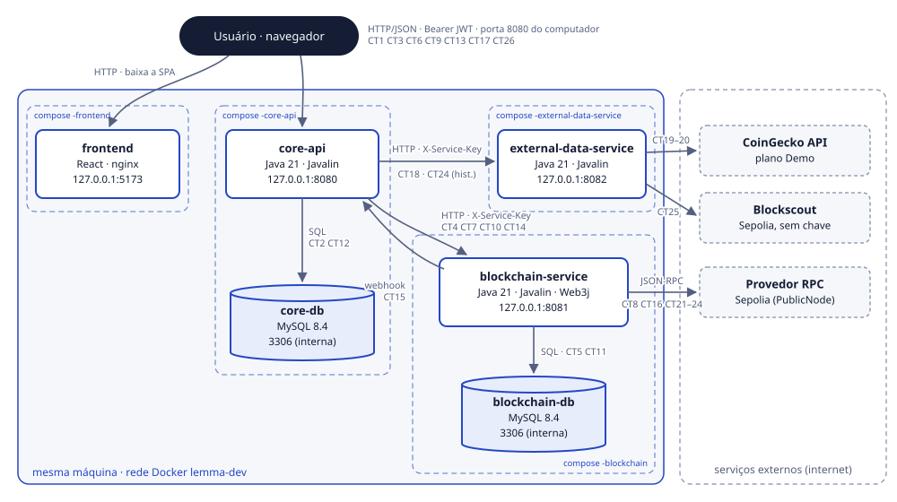

*Figura 1. Diagrama de contêineres. Cada moldura tracejada é o `docker-compose.yml` de um repositório, e as seis caixas são os serviços desses composes, com os mesmos nomes. Cada seta diz o meio e os contratos que passam por ela. O canal de Socket da versão 1.1 (CT27, porta interna 9091, entre o Blockchain Service e o Core API) acompanha a seta do webhook e é descrito em 4.3.*

### 4.2 Implantação com Docker

| Serviço | Compose (repositório) | Imagem | Porta | Publicada ou interna | Redes | Depende de |
|---|---|---|---|---|---|---|
| `frontend` | `-frontend` | construída do repositório: `node:26.13.1-trixie-slim` (build) e `nginxinc/nginx-unprivileged:1.30.6-alpine3.24` | 8080 no contêiner | publicada em `127.0.0.1:5173` | padrão | `core-api` no ar (o navegador o chama em `localhost:8080`) |
| `core-api` | `-core-api` | construída do repositório: `maven:3.9.16-eclipse-temurin-21` (build) e `eclipse-temurin:21.0.13_9-jre-noble` | 8080 | publicada em `127.0.0.1:8080` (o navegador chama) | padrão e `lemma-dev` | `core-db` saudável; `blockchain-service` e `external-data-service` na `lemma-dev` |
| `core-db` | `-core-api` | `mysql:8.4.13` | 3306 | interna | padrão | nenhum |
| `blockchain-service` | `-blockchain` | construída do repositório (mesmas imagens Java) | 8081 e 9091 | 8081 publicada em `127.0.0.1:8081` (testes por `curl`); 9091 (Socket) interna | padrão e `lemma-dev` | `blockchain-db` saudável; `core-api` na `lemma-dev` para o webhook (o `core-api` conecta na 9091 por Socket) |
| `blockchain-db` | `-blockchain` | `mysql:8.4.13` | 3306 | interna | padrão | nenhum |
| `external-data-service` | `-external-data-service` | construída do repositório (mesmas imagens Java) | 8082 | publicada em `127.0.0.1:8082` (testes por `curl`) | só `lemma-dev` | nenhum |

Notas de implantação:

- A rede `lemma-dev` é declarada como `external` nos composes do Core API, do Blockchain Service e do External Data Service. Dentro dela, cada serviço é encontrado pelo nome (`http://core-api:8080`, `http://blockchain-service:8081`, `http://external-data-service:8082`). Os bancos ficam só na rede padrão do seu compose e não são alcançáveis pelos outros módulos.
- Cada repositório tem o seu `.env` (fora do git), criado do `.env.example`. A `SERVICE_KEY` precisa ser a mesma nos três backends.
- O `depends_on` só vale dentro de um compose. Entre módulos não há ordem garantida pelo Docker: cada serviço só chama o outro quando atende uma requisição e devolve `502` se ele não estiver no ar. O README sobe na ordem Blockchain Service, External Data Service, Core API e Frontend.
- O `schema.sql` de cada módulo é executado pelo MySQL na criação do volume.
- Os bancos têm `healthcheck` (`mysqladmin ping`), e cada serviço Java só sobe depois do seu banco saudável. O Hibernate só valida o esquema; não cria tabelas.
- O `blockchain-service` tem `stop_grace_period: 40s`, porque o processo espera até 30 s o ciclo do worker terminar antes de fechar o banco.
- A porta 9091 do `blockchain-service` (Socket, ADR 0008) não é publicada no computador. Só os serviços da `lemma-dev` a alcançam, e quem se conecta precisa enviar a `SERVICE_KEY`. Variáveis: `TASK_SOCKET_PORT` (padrão 9091; 0 desliga o canal) no Blockchain Service; `TASK_SOCKET_HOST` (padrão `blockchain-service`) e `TASK_SOCKET_PORT` no Core API.
- Volumes nomeados: `core-db-data` e `blockchain-db-data`. Apagar o volume do Blockchain Service apaga as chaves das carteiras.
- Imagens Java rodam como usuário não root; o nginx também (`nginx-unprivileged`).

### 4.3 Comunicação entre os backends

Os backends conversam por **HTTP/1.1 sobre TCP, com corpo JSON**, na rede Docker `lemma-dev`, chamando uns aos outros pelo nome do serviço. O sistema não usa WebSocket. Além do HTTP, há um canal de **Socket Java** (TCP, com objetos Java serializados) pelo qual o Blockchain Service avisa o Core API da task concluída, descrito logo abaixo da tabela (ADR 0008). O restante da troca de mensagens, sem conexão permanente, foi decidido no ADR 0002 (tasks com `202`, webhook e consulta ativa), e o formato de cada mensagem está nas fichas CT.

| Ligação | Servidor (porta) | Cliente | Mensagens | Autenticação | Tempo limite | Quando a conexão cai |
|---|---|---|---|---|---|---|
| Operações de carteira | `blockchain-service` (8081) | `core-api` | CT4, CT7, CT10, CT14 | `X-Service-Key` | 15 s | O Core API responde `502` (`WALLET_UNAVAILABLE` no cadastro, `BLOCKCHAIN_UNAVAILABLE` no saldo e no envio). No cadastro, o usuário não é gravado. No acompanhamento (CT13), o Core API devolve o último estado local, sem erro. Não há retentativa automática do envio, para não duplicar transações. |
| Aviso de task concluída (webhook) | `core-api` (8080) | `blockchain-service` | CT15 | `X-Service-Key` | 5 s | O aviso é registrado no log e não é repetido (P4). O estado final já está gravado no Blockchain Service e chega ao Core API pela consulta ativa (CT14) no próximo polling do Frontend. |
| Aviso de task concluída (Socket) | `blockchain-service` (9091) | `core-api` | CT27 (`SubscribeRequest`, `TaskCompletedNotice`, `ShutdownNotice`) | `serviceKey` na primeira mensagem | 5 s para assinar | O Core API tenta reconectar a cada 5 s. Avisos perdidos não são reenviados (não há confirmação): o estado final chega pelo webhook ou pela consulta ativa (CT14). |
| Mercado e histórico | `external-data-service` (8082) | `core-api` | CT18, CT24 (histórico) | `X-Service-Key` | 15 s | O Core API responde `502 MARKET_DATA_UNAVAILABLE` ou `502 HISTORY_UNAVAILABLE`; o resto da carteira segue funcionando. |
| Rede Ethereum | Provedor RPC (HTTPS, externo) | `blockchain-service` | CT8, CT16, CT21 a CT24 | nenhuma | 10 s | Saldo: `502 RPC_UNAVAILABLE`. Antes de assinar: task `FAILED/INTERNAL_ERROR` (nada foi enviado). Depois de assinar: a task fica `PENDING` e o worker tenta de novo no ciclo seguinte (5 s), reenviando a mesma transação assinada. |
| Dados de mercado | CoinGecko (HTTPS, externo) | `external-data-service` | CT19, CT20 | `x-cg-demo-api-key` | 6 s por chamada | `502 MARKET_DATA_UNAVAILABLE`, sem resposta parcial e sem retentativa. |
| Histórico de endereço | Blockscout Sepolia (HTTPS, externo) | `external-data-service` | CT25 | nenhuma | 6 s | `502 HISTORY_UNAVAILABLE`; o resultado bom fica 12 s em cache por endereço. |
| Navegador | `core-api` (8080, no host) | Frontend no navegador | CT1, CT3, CT6, CT9, CT13, CT17, CT26 | JWT `Bearer` | 20 s no cliente | Envio com resultado incerto: a tela avisa e não reenvia sozinha. Polling: mantém o último estado, mostra "Reconectando…" e aumenta o intervalo (3, 6 e 10 s). |

Todos os erros HTTP têm o mesmo formato: status mais corpo JSON com `code` e `message`. A `X-Service-Key` é comparada em tempo constante e exigida em todas as rotas internas.

**Canal de Socket (ADR 0008).** Acrescentado na versão 1.1 para usar Socket Java na comunicação entre módulos, seguindo o exemplo fornecido na disciplina: servidor com `ServerSocket`, uma thread por conexão e mensagens `Serializable` em `ObjectInputStream` e `ObjectOutputStream`. O webhook CT15 e a consulta ativa continuam como estavam; o Socket é um terceiro caminho para o mesmo aviso.

- **Servidor:** o Blockchain Service abre um `ServerSocket` na porta interna 9091. Uma thread aceita conexões e cada conexão tem a sua thread. Quem se conecta envia um `SubscribeRequest` com a `SERVICE_KEY` em até 5 s; chave errada, mensagem de outro tipo ou silêncio fecham a conexão.
- **Cliente:** o Core API mantém uma thread que se conecta, assina e fica ouvindo. Ao receber um `TaskCompletedNotice`, aplica o estado pela mesma regra do webhook CT15. Se a conexão cai ou chega um `ShutdownNotice`, espera 5 s e reconecta.
- **Envio:** o Blockchain Service avisa pelo Socket quando a task chega a `CONFIRMED` ou `FAILED`. Falha no Socket nunca altera o estado da task nem impede o webhook.
- **Segurança:** a desserialização de objetos Java é um risco conhecido; por isso os dois lados usam um `ObjectInputFilter` que só aceita as classes do pacote `com.lemma.socket` e `String`, com limite de tamanho. A porta não é publicada no computador.
- **Limitações:** não há confirmação de recebimento nem retentativa. Quem estiver desconectado perde o aviso e recupera o estado pela consulta ativa (CT14).

As classes seguem a estrutura do exemplo da disciplina, com nomes em inglês:

| Exemplo da disciplina | Lemma | Onde |
|---|---|---|
| `Servidor` (montagem) | `Main` | Blockchain Service |
| `AceitadoraDeConexao` | `ConnectionAcceptor` | Blockchain Service |
| `SupervisoraDeConexao` | `ConnectionSupervisor` | Blockchain Service |
| lista de usuários e envio a todos | `subscribers` e `TaskNoticeBroadcaster` | Blockchain Service |
| `Parceiro` | `Partner` | Blockchain Service e Core API |
| `Comunicado` | `Message`, com `SubscribeRequest` e `TaskCompletedNotice` | Blockchain Service e Core API |
| `ComunicadoDeDesligamento` | `ShutdownNotice` | Blockchain Service e Core API |
| `Cliente` e `TratadoraDeComunicadoDeDesligamento` | `TaskNoticeListener` | Core API |

### 4.4 Tecnologias

| Camada | Tecnologia e versão | Por que a equipe escolheu |
|---|---|---|
| Linguagem dos backends | Java 21 (Eclipse Temurin) | Requisito da disciplina; versão LTS. |
| Servidor HTTP | Javalin 7.2.4 | Framework leve, sem a configuração de um Spring; poucas linhas por rota. |
| JSON | Jackson 2.22.4 (2.23.0 no External Data Service) | Padrão em Java; usado também pelo Javalin. |
| Persistência | Hibernate 7.4.15 + HikariCP, MySQL Connector/J 26.10.0 | Mapeamento das tabelas sem escrever SQL repetido; o pool sobrevive à queda do banco. |
| Banco de dados | MySQL 8.4.13 | Relacional, conhecido pela equipe, imagem oficial estável. Um banco por serviço com estado. |
| Ethereum | Web3j 6.1.0 | Biblioteca Java de referência para gerar chaves, assinar e falar JSON-RPC. |
| Criptografia da chave privada | AES-256-GCM do `javax.crypto` | Sigilo e integridade sem biblioteca extra (ADR 0003). |
| Autenticação | `java-jwt` 4.6.2 (HS256) e `bcrypt` 0.10.2 (custo 12) | Um artefato só, sem estado no servidor (ADR 0004). |
| Testes dos backends | JUnit 5.14.4 | Padrão em Java. |
| Frontend | React 19.3, TypeScript 6.0, React Router 8.5 | Requisito do projeto; SPA sem SSR. |
| Estilo | Tailwind CSS 4.3, fonte Jost | Tokens da identidade do Lemma direto no CSS. |
| Build e testes do Frontend | Vite 8.3, Vitest 5.1 | Build rápido; testes com relógio falso para o polling. |
| Servidor do Frontend | nginx 1.30.6 (imagem sem root) | Serve o build estático com fallback de SPA e cabeçalhos de segurança (CSP). |
| Contêineres | Docker e Docker Compose, um compose por repositório, rede externa `lemma-dev` | Requisito da disciplina; cada módulo sobe com um comando e é testado isolado. |
| Socket entre serviços | `java.net.Socket`, `ServerSocket` e serialização de objetos Java, só com o JDK | Requisito da disciplina; segue o exemplo fornecido (ADR 0008). |
| Rede | Ethereum Sepolia via PublicNode (JSON-RPC público) | Gratuito, sem conta; testado em 07/11/2026. |
| Mercado | CoinGecko, plano Demo | Gratuito, com preço e série histórica. |
| Histórico | Blockscout público da Sepolia | Gratuito e sem chave; 180 requisições por minuto. |

---

## 5. Banco de dados

> Responsável: Guillermo Perdomo Sevilla Neto

O sistema tem **dois bancos MySQL separados**, um por serviço com estado (ADR 0001). Não há chave estrangeira entre eles: o Core API só conhece o endereço público da carteira e o `task_id`, e o Blockchain Service não conhece usuários. O diagrama foi conferido tabela por tabela contra o `schema.sql` de cada módulo (o mesmo que o compose do módulo executa).

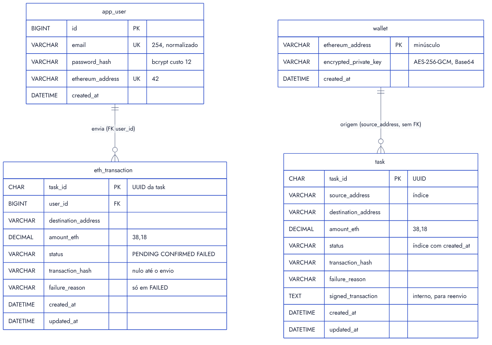

*Figura 2. À esquerda, o Banco do Core API (`core`); à direita, o Banco do Blockchain Service (`blockchain`).*

| Tabela | Banco | O que guarda |
|---|---|---|
| `app_user` | `core` | Um usuário: e-mail (único), hash bcrypt da senha e o endereço público da carteira (único) criada no cadastro. |
| `eth_transaction` | `core` | Cópia local de cada envio feito pelo usuário (1:N com `app_user` por `user_id`), com estado, hash e motivo de falha, para o Frontend fazer polling sem ir à rede. A chave é o `task_id` vindo do Blockchain Service. |
| `wallet` | `blockchain` | Uma carteira: endereço (em minúsculas) e a chave privada cifrada com AES-256-GCM, com o endereço como dado associado. |
| `task` | `blockchain` | Cada pedido de envio: origem, destino, valor, estado, hash, motivo de falha e a transação assinada (para reenvio após queda). Índices por estado e por origem, usados pelo worker. A ligação com `wallet` (1:N por `source_address`) é lógica, sem FK. |

Ligações lógicas entre os bancos, garantidas pelo código e não pelo banco: `app_user.ethereum_address` = `wallet.ethereum_address`, e `eth_transaction.task_id` = `task.task_id`. O detalhe campo a campo está nas fichas CT2, CT5, CT11 e CT12.

---

## 6. Contratos e decisões

> Responsável: Guillermo Perdomo Sevilla Neto

### 6.1 Contratos

Cada ficha fica no repositório do módulo que **responde** à chamada (o Blockchain Service também guarda uma cópia do CT15). Fichas que mudaram durante o desenvolvimento foram atualizadas nos repositórios; a Especificação da Entrega 2 não foi reemitida.

| CT | Nome | Fronteira | Ficha |
|---|---|---|---|
| CT1 | `registerUser` | Frontend → Core API (HTTP) | [Core API](https://github.com/IgorFurtadoo/pi4-2026-2-0101-grupo07-core-api/blob/main/docs/contratos/CT1-registerUser.md) |
| CT2 | `app_user` | Core API → Banco do Core API | [Core API](https://github.com/IgorFurtadoo/pi4-2026-2-0101-grupo07-core-api/blob/main/docs/contratos/CT2-app_user.md) |
| CT3 | `authenticateUser` | Frontend → Core API (HTTP) | [Core API](https://github.com/IgorFurtadoo/pi4-2026-2-0101-grupo07-core-api/blob/main/docs/contratos/CT3-authenticateUser.md) |
| CT4 | `createWallet` | Core API → Blockchain Service (HTTP) | [Blockchain](https://github.com/IgorFurtadoo/pi4-2026-2-0101-grupo07-blockchain/blob/main/docs/contratos/CT4-createWallet.md) |
| CT5 | `wallet` | Blockchain Service → seu banco | [Blockchain](https://github.com/IgorFurtadoo/pi4-2026-2-0101-grupo07-blockchain/blob/main/docs/contratos/CT5-wallet.md) |
| CT6 | `getBalance` | Frontend → Core API (HTTP) | [Core API](https://github.com/IgorFurtadoo/pi4-2026-2-0101-grupo07-core-api/blob/main/docs/contratos/CT6-getBalance.md) |
| CT7 | `getWalletBalance` | Core API → Blockchain Service (HTTP) | [Blockchain](https://github.com/IgorFurtadoo/pi4-2026-2-0101-grupo07-blockchain/blob/main/docs/contratos/CT7-getWalletBalance.md) |
| CT8 | `rpcGetBalance` | Blockchain Service → Provedor RPC | [Blockchain](https://github.com/IgorFurtadoo/pi4-2026-2-0101-grupo07-blockchain/blob/main/docs/contratos/CT8-rpcGetBalance.md) |
| CT9 | `sendTransaction` | Frontend → Core API (HTTP) | [Core API](https://github.com/IgorFurtadoo/pi4-2026-2-0101-grupo07-core-api/blob/main/docs/contratos/CT9-sendTransaction.md) |
| CT10 | `requestTransactionSubmission` | Core API → Blockchain Service (HTTP) | [Blockchain](https://github.com/IgorFurtadoo/pi4-2026-2-0101-grupo07-blockchain/blob/main/docs/contratos/CT10-requestTransactionSubmission.md) |
| CT11 | `task` | Blockchain Service → seu banco | [Blockchain](https://github.com/IgorFurtadoo/pi4-2026-2-0101-grupo07-blockchain/blob/main/docs/contratos/CT11-task.md) |
| CT12 | `eth_transaction` | Core API → Banco do Core API | [Core API](https://github.com/IgorFurtadoo/pi4-2026-2-0101-grupo07-core-api/blob/main/docs/contratos/CT12-eth_transaction.md) |
| CT13 | `getTransaction` | Frontend → Core API (HTTP) | [Core API](https://github.com/IgorFurtadoo/pi4-2026-2-0101-grupo07-core-api/blob/main/docs/contratos/CT13-getTransaction.md) |
| CT14 | `getTask` | Core API → Blockchain Service (HTTP) | [Blockchain](https://github.com/IgorFurtadoo/pi4-2026-2-0101-grupo07-blockchain/blob/main/docs/contratos/CT14-getTask.md) |
| CT15 | `notifyTaskCompleted` | Blockchain Service → Core API (webhook) | [Core API](https://github.com/IgorFurtadoo/pi4-2026-2-0101-grupo07-core-api/blob/main/docs/contratos/CT15-notifyTaskCompleted.md) |
| CT16 | `rpcGetTransactionReceipt` | Blockchain Service → Provedor RPC | [Blockchain](https://github.com/IgorFurtadoo/pi4-2026-2-0101-grupo07-blockchain/blob/main/docs/contratos/CT16-rpcGetTransactionReceipt.md) |
| CT17 | `getMarketData` | Frontend → Core API (HTTP) | [Core API](https://github.com/IgorFurtadoo/pi4-2026-2-0101-grupo07-core-api/blob/main/docs/contratos/CT17-getMarketData.md) |
| CT18 | `fetchMarketData` | Core API → External Data Service (HTTP) | [External Data](https://github.com/IgorFurtadoo/pi4-2026-2-0101-grupo07-external-data-service/blob/main/docs/contratos/CT18-fetchMarketData.md) |
| CT19 | `coingeckoGetSimplePrice` | External Data Service → CoinGecko | [External Data](https://github.com/IgorFurtadoo/pi4-2026-2-0101-grupo07-external-data-service/blob/main/docs/contratos/CT19-coingeckoGetSimplePrice.md) |
| CT20 | `coingeckoGetMarketChart` | External Data Service → CoinGecko | [External Data](https://github.com/IgorFurtadoo/pi4-2026-2-0101-grupo07-external-data-service/blob/main/docs/contratos/CT20-coingeckoGetMarketChart.md) |
| CT21 | `rpcGetTransactionCount` | Blockchain Service → Provedor RPC | [Blockchain](https://github.com/IgorFurtadoo/pi4-2026-2-0101-grupo07-blockchain/blob/main/docs/contratos/CT21-rpcGetTransactionCount.md) |
| CT22 | `rpcGetGasPrice` | Blockchain Service → Provedor RPC | [Blockchain](https://github.com/IgorFurtadoo/pi4-2026-2-0101-grupo07-blockchain/blob/main/docs/contratos/CT22-rpcGetGasPrice.md) |
| CT23 | `rpcSendRawTransaction` | Blockchain Service → Provedor RPC | [Blockchain](https://github.com/IgorFurtadoo/pi4-2026-2-0101-grupo07-blockchain/blob/main/docs/contratos/CT23-rpcSendRawTransaction.md) |
| CT24 | `rpcGetTransactionByHash` (novo) | Blockchain Service → Provedor RPC | [Blockchain](https://github.com/IgorFurtadoo/pi4-2026-2-0101-grupo07-blockchain/blob/main/docs/contratos/CT24-rpcGetTransactionByHash.md) |
| CT24 ⚠ | `fetchAddressTransactions` (novo) | Core API → External Data Service (HTTP) | [External Data](https://github.com/IgorFurtadoo/pi4-2026-2-0101-grupo07-external-data-service/blob/main/docs/contratos/CT24-fetchAddressTransactions.md) |
| CT25 | `blockscoutGetAddressTransactions` (novo) | External Data Service → Blockscout | [External Data](https://github.com/IgorFurtadoo/pi4-2026-2-0101-grupo07-external-data-service/blob/main/docs/contratos/CT25-blockscoutGetAddressTransactions.md) |
| CT26 | `getWalletTransactions` (novo) | Frontend → Core API (HTTP) | [Core API](https://github.com/IgorFurtadoo/pi4-2026-2-0101-grupo07-core-api/blob/main/docs/contratos/CT26-getWalletTransactions.md) |
| CT27 | `subscribeTaskNotices` (novo, v1.1) | Core API → Blockchain Service (Socket TCP, objetos Java) | [Blockchain](https://github.com/IgorFurtadoo/pi4-2026-2-0101-grupo07-blockchain/blob/main/docs/contratos/CT27-subscribeTaskNotices.md) |

⚠ **Número repetido.** O CT24 foi criado duas vezes, em módulos diferentes e com sentidos diferentes. Neste documento, "CT24" sem complemento é o `rpcGetTransactionByHash`; o `fetchAddressTransactions` é citado sempre pelo nome. A correção registrada como defeito D-01 (capítulo 7) é dar a ele o próximo número livre, sem renumerar os demais.

Fluxos: [`docs/fluxos/`](https://github.com/IgorFurtadoo/pi4-2026-2-0101-grupo07-frontend/tree/main/docs/fluxos) (visão geral e E1 a E9) e [`fluxo-e9-retomada.md`](https://github.com/IgorFurtadoo/pi4-2026-2-0101-grupo07-blockchain/blob/main/docs/fluxo-e9-retomada.md) (E9 reescrito).

### 6.2 Decisões (ADRs)

| ADR | Título | Status | Arquivo |
|---|---|---|---|
| 0001 | Isolar a integração com a Ethereum em um serviço próprio | Aceito | [Blockchain](https://github.com/IgorFurtadoo/pi4-2026-2-0101-grupo07-blockchain/blob/main/docs/adr/0001-isolar-a-integracao-com-a-ethereum-em-um-servico-proprio.md) |
| 0002 | Processar operações demoradas de blockchain como tasks assíncronas | Aceito | [Blockchain](https://github.com/IgorFurtadoo/pi4-2026-2-0101-grupo07-blockchain/blob/main/docs/adr/0002-processar-operacoes-demoradas-de-blockchain-como-tasks-assincronas.md) |
| 0003 | Cifrar a chave privada das carteiras com AES-256-GCM | Aceito | [Blockchain](https://github.com/IgorFurtadoo/pi4-2026-2-0101-grupo07-blockchain/blob/main/docs/adr/0003-cifrar-a-chave-privada-das-carteiras-com-aes-256-gcm.md) |
| 0004 | Autenticar com JWT HS256 e senha em bcrypt | Aceito | [Core API](https://github.com/IgorFurtadoo/pi4-2026-2-0101-grupo07-core-api/blob/main/docs/adr/0004-autenticar-com-jwt-hs256-e-bcrypt.md) |
| 0005 | Assinar as transações com limite de gás fixo de 500.000 (novo) | Aceito | [Blockchain](https://github.com/IgorFurtadoo/pi4-2026-2-0101-grupo07-blockchain/blob/main/docs/adr/0005-assinar-transacoes-com-limite-de-gas-fixo-de-500000.md) |
| 0006 | Separar a integração com APIs externas em um serviço próprio (novo) | Aceito | [External Data](https://github.com/IgorFurtadoo/pi4-2026-2-0101-grupo07-external-data-service/blob/main/docs/adr/0006-separar-a-integracao-com-apis-externas-em-um-servico-proprio.md) |
| 0007 | Ler o histórico da carteira do Blockscout público (novo) | Aceito | [External Data](https://github.com/IgorFurtadoo/pi4-2026-2-0101-grupo07-external-data-service/blob/main/docs/adr/0007-ler-o-historico-da-carteira-do-blockscout-publico.md) |
| 0008 | Avisar a task concluída também por Socket Java (novo, v1.1) | Aceito | [Blockchain](https://github.com/IgorFurtadoo/pi4-2026-2-0101-grupo07-blockchain/blob/main/docs/adr/0008-avisar-task-concluida-tambem-por-socket.md) |

Os ADRs 0005 a 0007 registram decisões tomadas durante o desenvolvimento que ainda não tinham ADR. O ADR 0008 (versão 1.1) acrescenta o canal de Socket sem substituir o webhook. Outras divergências entre a Especificação e o sistema que roda (hash gravado antes do envio, retomada pelo primeiro ciclo do worker, `X-Service-Key` também no External Data Service) estão registradas no desenho de cada módulo (`docs/desenho-*.md`).

---

## 7. Testes

> Responsável: Nicollas Fabbio

### 7.1 Estratégia

Cada backend tem testes JUnit sem rede: regras de negócio com dependências falsas (repositórios em memória, clientes HTTP falsos, relógio falso) e clientes HTTP contra um servidor local do JDK que confere método, caminho, cabeçalhos e corpo. O Frontend tem testes Vitest de funções, hooks (com relógio falso para o polling) e telas. O que só se prova com a rede real foi testado à mão, com roteiros versionados (`scripts/` do Core API e do Blockchain Service) contra a Sepolia, o MySQL de verdade, a CoinGecko e o Blockscout, e os resultados ficaram registrados no desenho de cada módulo. Testes de tela no navegador foram feitos no Chrome. **Não há integração contínua (CI) nem SonarQube configurados nesta versão** (ver 7.2).

### 7.2 Testes automatizados

| Módulo | Testes no código-fonte (26/11/2026) | Última execução registrada | Comando |
|---|---|---|---|
| Core API | 449 métodos `@Test`/`@ParameterizedTest` em 28 classes | 26/11/2026: 449 testes, 0 falhas (o erro do D-06, visto em 23/11 com os três backends compilando juntos, não se repetiu) | `mvn clean test` |
| Blockchain Service | 159 métodos em 14 classes | 26/11/2026: 169 testes executados, 0 falhas | `mvn clean test` |
| External Data Service | 87 métodos em 10 classes | 23/11/2026: 87 testes, 0 falhas | `mvn clean test` |
| Frontend | 453 casos `it`/`test` em 37 arquivos (casos com `.each` se multiplicam na execução) | 26/11/2026: 684 testes executados, 0 falhas | `npm test` |

| Item | Situação |
|---|---|
| CI (GitHub Actions) | **Não configurado.** Os testes rodam localmente. |
| SonarQube (cobertura, bugs, quality gate) | **Não configurado.** |

### 7.3 Casos de teste

Situação: **Passou** (execução registrada, com a data), **Passou (auto)** (coberto por teste automatizado na última execução registrada), **Não executado**. Os testes marcados com † precisam ser repetidos com as releases `v1.0` e `v1.1`.

| TE | Verifica | Passos | Esperado | Obtido | Situação |
|---|---|---|---|---|---|
| TE-01 | E1, E2, CT1 | Cadastrar e-mail novo e senha válida | `201` com `userId`, `email` e `ethereumAddress`; tela de confirmação mostra só o endereço | Pelo navegador: tela "Sua carteira foi criada" com `0x9050…9B43`, sem chave privada (8.3); antes, `e2e-demo.sh` com `201` (16/11) | Passou (23/11) |
| TE-02 | E1, CT1, RNF-07 | Cadastrar e-mail já existente | `409 EMAIL_ALREADY_REGISTERED`, sem criar carteira | Testes `UserServiceTest` e `UserControllerTest` | Passou (auto) |
| TE-03 | E1, CT1 | Cadastrar com senha de 7 caracteres e com senha acima de 72 bytes | `400 PASSWORD_INVALID`; o Frontend avisa antes de enviar | A tela aponta os dois erros no campo e não envia (8.2); servidor coberto por testes do Core API | Passou (23/11) |
| TE-04 | E1, CT3, RNF-07 | Entrar com senha errada; entrar com e-mail inexistente | `401 INVALID_CREDENTIALS` nos dois, mesma mensagem; nenhum token guardado | A tela mostra "E-mail ou senha incorretos" e não libera o acesso (8.4); testes `AuthServiceTest` | Passou (23/11) |
| TE-05 | E1, CT26 | Chamar rota protegida sem token | `401 TOKEN_INVALID` | `GET /wallet/transactions` sem token: `401 TOKEN_INVALID` | Passou (19/11) |
| TE-06 | E2, CT4, CT5, RNF-08 | Criar carteira e ler a linha no banco | Resposta só com o endereço; coluna com Base64 de 80 caracteres, não hexadecimal | Smoke `smoke-wallet.sh` e leitura do banco | Passou (07/11) |
| TE-07 | E2, CT1 | Cadastrar com o Blockchain Service fora | `502 WALLET_UNAVAILABLE`; usuário não gravado | `UserServiceTest` com cliente falso | Passou (auto) |
| TE-08 | E3, CT6, CT7, CT8 | Abrir a carteira antes e depois de receber ETH | Saldo igual ao lido na rede, sem arredondar | `0` → `0,835` → `0,832999999999664` ETH depois de um envio (8.5, 8.7, 8.12); em 16/11, valores iguais ao CT7 | Passou (23/11) |
| TE-09 | E3, RNF-02 | Consultar saldo com o RPC inacessível | `502 RPC_UNAVAILABLE` no Blockchain Service e `502 BLOCKCHAIN_UNAVAILABLE` no Core API; login segue funcionando | Com o `blockchain-service` parado: aviso "A rede Sepolia não está acessível agora", mercado e atividade normais (8.13) | Passou (23/11) |
| TE-10 | E4, CT9, CT10, RNF-06 | Enviar 0.0005 ETH a um endereço válido | `202` com `taskId` na hora; a tela abre `/transacoes/{taskId}` | Envio real de 0,002 ETH pelo navegador; a tela de acompanhamento abre com o identificador (8.10) | Passou (23/11) |
| TE-11 | E4, CT9 | Enviar para endereço inválido; enviar valor 0 | `400 ADDRESS_INVALID`; `400 AMOUNT_INVALID`; mensagem no campo | Conferido por `curl` e por `SendPage.test` | Passou (17/11) |
| TE-12 | E4 | Dar dois cliques seguidos em "Confirmar envio" | Uma única chamada ao CT9 | `SendPage.test` (trava por `ref`) | Passou (auto) |
| TE-13 | E5, CT13, RNF-06 | Ficar na tela da transação até o fim | "Pendente" vira "Confirmada" sem recarregar; polling para | "Aguardando confirmação" (20:38:57) virou "Confirmada" (20:39:13) sem recarregar; tx `0x6a03…3e68` (8.10, 8.11) | Passou (23/11) |
| TE-14 | E5, CT23 | Enviar de uma carteira sem saldo | Task `FAILED` com `REJECTED_BY_NETWORK` e mensagem em português | `smoke-tasks.sh`: `FAILED/REJECTED_BY_NETWORK` em ~6 s (nó respondeu `insufficient funds`) | Passou (08/11) |
| TE-15 | E5, CT14, CT15, RNF-04 | Webhook chega antes de o Core API ter a linha (404) | Estado final gravado pela consulta ativa no `GET` seguinte | Linha seguiu `PENDING` 12 s; o `GET` gravou `CONFIRMED` com hash | Passou (16/11) |
| TE-16 | E5, CT15 | 16 notificações contraditórias simultâneas por linha, em 50 linhas | Cada linha termina igual a uma das notificações, sem mistura de campos; estado final não regride | 1.200 notificações e 500 `GET`, nenhum 5xx; 19 `CONFIRMED`, 31 `FAILED`, sem mistura | Passou (16/11) |
| TE-17 | E6, CT17 a CT20 | Abrir a carteira | Preço atual em US$ e gráfico de 7 dias | Preço e série reais (169 pontos) exibidos | Passou (19/11) |
| TE-18 | E6, RNF-03 | Abrir a carteira com o External Data Service fora | Painel "indisponível" com botão de tentar de novo; saldo normal | Testes com servidor falso; `MarketPanel.test` | Passou (auto) |
| TE-19 | E7, CT17 | 11 requisições de mercado em 60 s | 11ª recebe `429 RATE_LIMIT_EXCEEDED` com `Retry-After`; o External Data Service não recebe a 11ª | `SlidingWindowRateLimiterTest` e teste HTTP com serviço falso | Passou (auto) |
| TE-20 | E7 | Teste manual de carga: 20 requisições simultâneas a `GET /market/ethereum` | 10 respostas `200` e 10 `429`; nenhum `429` vindo da CoinGecko | — | Não executado |
| TE-21 | E8 | Envio real com Core API, Blockchain Service e bancos em contêineres separados | Transação percorre Core API → Blockchain Service → RPC e volta ao usuário | Tx `0x846b…65c8`, bloco 12144806, `CONFIRMED` pelo webhook | Passou (16/11) † |
| TE-22 | E9, RNF-05 | Reiniciar o `blockchain-service` com uma task pendente (antes e depois do envio, e com `kill`) | Task segue consultável e termina `CONFIRMED`, uma transação por rodada | Três rodadas `CONFIRMED` (blocos 12142400, 12142402, 12142405); 7 testes `TaskWorkerRestartTest` | Passou (15/11) |
| TE-23 | E10, CT26 | Abrir a carteira de um endereço com transações | Lista com até 20 transações, direção e link | Lista com a recebida (+0,835) e a enviada (−0,002), confirmadas, com link (8.12); em 19/11, 13 transações e `502 HISTORY_UNAVAILABLE` com o serviço fora | Passou (23/11) |
| TE-24 | RNF-01 | Seguir o capítulo 9 numa máquina limpa (clonar os quatro repositórios, criar a `lemma-dev`, subir os quatro composes) | Seis contêineres em execução; app em `http://localhost:5173` | — | Não executado † |
| TE-25 | RNF-08 | Cifrar e decifrar; copiar a chave cifrada para outra linha | Decifra só na própria linha; nada da chave em log | `KeyCipherTest` (8 testes) | Passou (auto) |
| TE-26 | RNF-09, RNF-11 | Subir com segredos de exemplo; subir com `CHAIN_ID` diferente | Serviço sai com código 1 e mensagem clara | Testes `AppConfigTest` dos três backends | Passou (auto) |
| TE-27 | RNF-10 | `docker ps` com o sistema no ar | Bancos sem porta; 5173, 8080, 8081 e 8082 só em `127.0.0.1` | — | Não executado † |
| TE-28 | RNF-02 | Abrir a carteira com o Core API parado | Cada painel mostra erro com botão de tentar de novo, sem tela branca | "Não foi possível falar com o servidor" nos três painéis (8.13) | Passou (23/11) |
| TE-29 | E5, CT27, ADR 0008 | Com o Blockchain Service e o Core API da v1.1 no ar, enviar uma transação pela tela e ler os logs dos dois módulos | O Blockchain Service registra o aviso enviado por Socket e o Core API registra o aviso aplicado; a tela chega a "Confirmada" | Task `f9369f8e…`, bloco 12218434: aviso enviado por Socket às 19:11:28,952Z; aplicado pelo Core API às 19:11:29,006Z; webhook CT15 entregue depois, às 19:11:29,027Z (HTTP 204) | Passou (26/11) |
| TE-30 | E4, E5, E10 | Enviar uma transação, sair do acompanhamento e voltar à carteira | A transação aparece em "Em andamento", com link para o acompanhamento, até confirmar e entrar no histórico | Conferido no navegador em 26/11/2026: o envio aparece em "Em andamento" ao voltar à carteira | Passou (26/11) |

As transações citadas podem ser conferidas em `https://sepolia.etherscan.io/tx/<hash>`.

### 7.4 Resumo da execução

| Casos | Passou | Passou (auto) | Falhou | Não executado |
|---|---|---|---|---|
| 30 | 20 | 7 | 0 | 3 |

Última rodada manual registrada: 26/11/2026 (TE-29); os demais casos manuais são de 23/11/2026 ou anteriores. Os casos † devem ser repetidos sobre as releases `v1.0` e `v1.1` antes da apresentação.

### 7.5 Defeitos conhecidos

Nenhum defeito foi registrado como card no quadro do OpenProject. Os itens abaixo foram encontrados durante o desenvolvimento e os testes e continuam abertos na entrega.

| ID | Defeito | Severidade | Onde apareceu |
|---|---|---|---|
| D-01 | O número CT24 foi usado em dois contratos diferentes (`rpcGetTransactionByHash` e `fetchAddressTransactions`). | Baixa | Revisão dos contratos para este documento |
| D-02 | Uma task pode ficar `PENDING` para sempre se o nó responder "nonce too low" e não conhecer o hash; não há tempo limite de task. O Frontend mostra o aviso de demora após 10 minutos. | Média | Desenho do Blockchain Service (Fase A do worker) |
| D-03 | Se o envio estourar o tempo entre Core API e Blockchain Service, não há como saber se foi aceito; repetir pode gerar duas transações (sem idempotência no CT9/CT10). A tela avisa e não reenvia sozinha. | Média | Desenho do Core API e do Frontend |
| D-04 | Não há limite de tentativas de login. | Média | ADR 0004 |
| D-05 | A lista "Em andamento" (versão 1.1) fica só no navegador onde o envio foi feito: ao trocar de navegador ou limpar os dados dele, um envio ainda não minerado só pode ser reencontrado depois de minerado, pelo histórico (E10). | Baixa | Desenho do Frontend |
| D-06 | O teste `HttpBlockchainClientTest.successIsNotLogged` usa tempo limite de 1 s contra um servidor HTTP local e falha com a máquina sobrecarregada (1,1 s medido). Rodando sozinho, não ocorre. A correção é aumentar o limite nesse teste. | Baixa | `mvn clean test` de 23/11/2026 (7.2) |

Escala usada: **Crítica** (impede o uso), **Alta** (um entregável de prioridade Alta não funciona como no "feito quando"), **Média** (erro com forma de contornar), **Baixa** (problema visual, de texto ou de documentação).

---

## 8. Principais telas

> Responsável: Igor de Toledo Furtado

Prints da versão entregue (`v1.0`), no Chrome, na Sepolia, tirados em 23/11/2026 com os quatro módulos no ar, exceto em 8.13, onde módulos foram parados de propósito. Os prints são da versão 1.0. A versão 1.1 trocou o layout da carteira por blocos em grade (8.5, 8.7 e 8.12 mostram o layout anterior) e acrescentou a seção "Em andamento"; as demais telas não mudaram.

### 8.1 Login

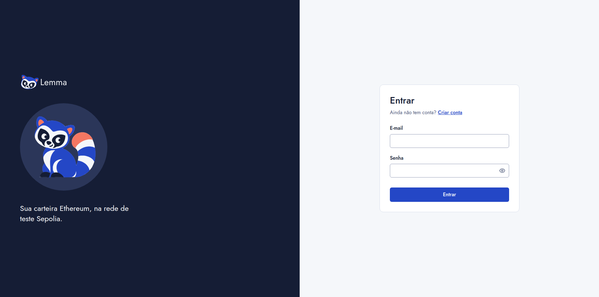

Entrada do sistema para quem já tem conta: e-mail e senha, com botão para mostrar a senha e link para criar conta. À esquerda, o logo e o mascote do Lemma. Atende o **E1**.

### 8.2 Cadastro

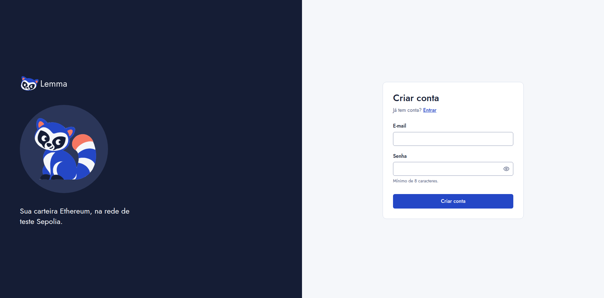

Criação de conta com e-mail e senha de no mínimo 8 caracteres. Não há campo de chave privada nem de carteira. Atende o **E1** e o **E2**.

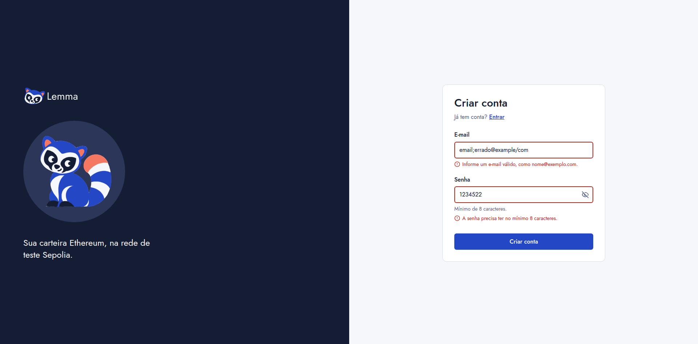

Validação antes de enviar: e-mail fora do formato e senha com menos de 8 caracteres são apontados no próprio campo. O Core API repete a mesma validação (TE-03).

### 8.3 Confirmação do cadastro

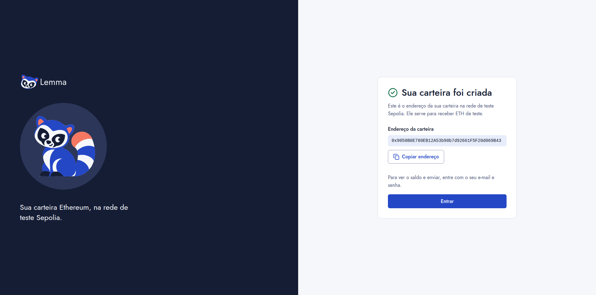

Ao concluir o cadastro, a tela mostra o endereço público da carteira criada automaticamente, com botão de copiar, e leva ao login. Nenhuma chave privada aparece. Atende o **E2**.

### 8.4 Login com senha incorreta

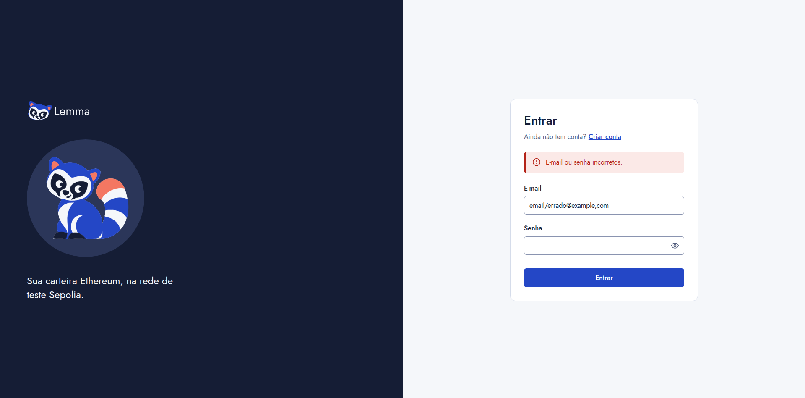

E-mail inexistente ou senha errada recebem a mesma mensagem, "E-mail ou senha incorretos", e o acesso não é liberado. Atende o **E1** (TE-04).

### 8.5 Carteira de um usuário novo

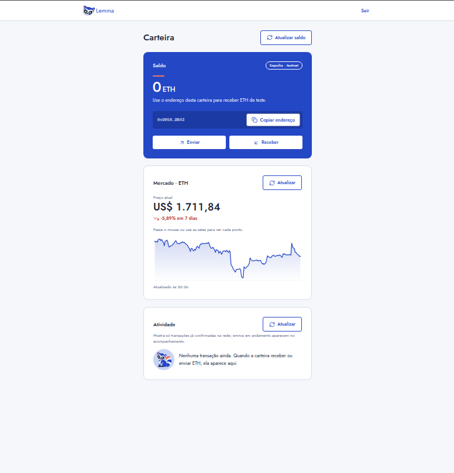

Tela principal logo após o primeiro login: saldo de 0 ETH lido da Sepolia (**E3**), endereço abreviado com botão de copiar, botões "Enviar" e "Receber", painel de mercado com o preço do ETH e o gráfico de 7 dias (**E6**) e a lista de atividade ainda vazia (**E10**).

### 8.6 Receber ETH

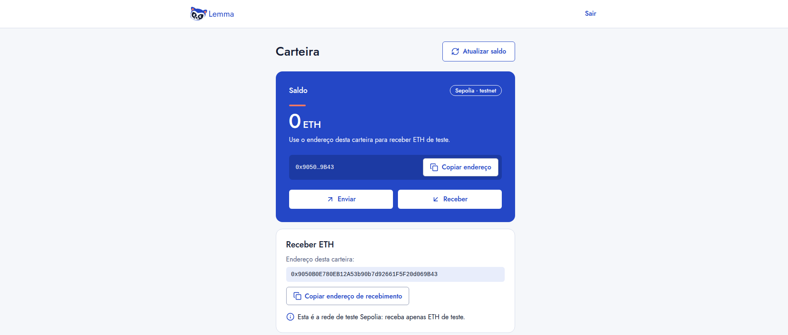

O painel "Receber" mostra o endereço completo para colar na torneira da Sepolia e avisa que só se deve receber ETH de teste. Apoia o **E3** e o abastecimento da carteira.

### 8.7 Carteira após receber ETH

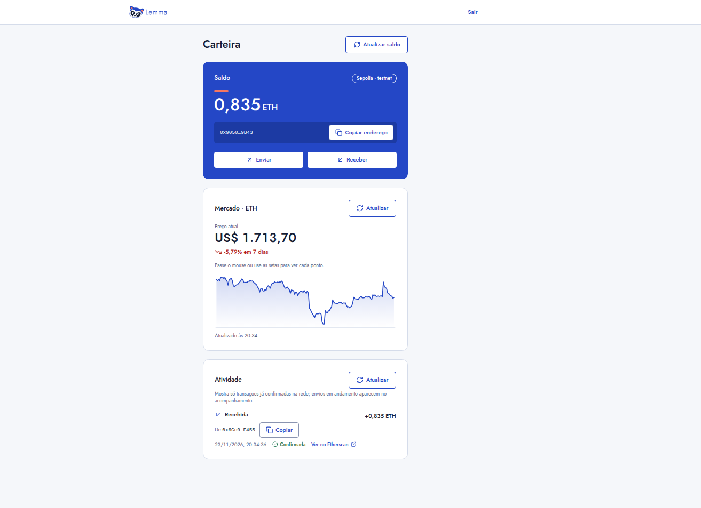

Depois do abastecimento, o saldo passa a 0,835 ETH e a atividade mostra a transação recebida, confirmada, com o remetente e o link para o Etherscan. Atende o **E3** e o **E10**.

### 8.8 Envio

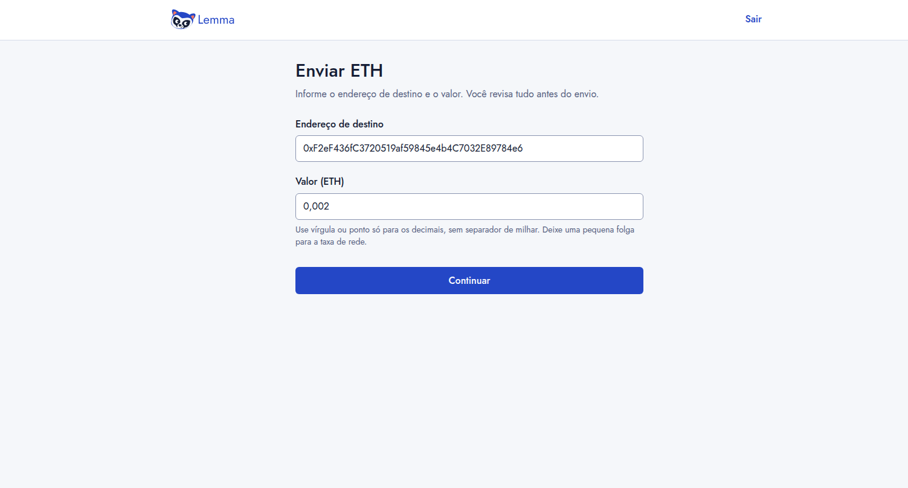

O usuário informa o endereço de destino e o valor (vírgula ou ponto como decimal). O texto de ajuda lembra de deixar folga para a taxa de rede. Atende o **E4**.

### 8.9 Revisão do envio

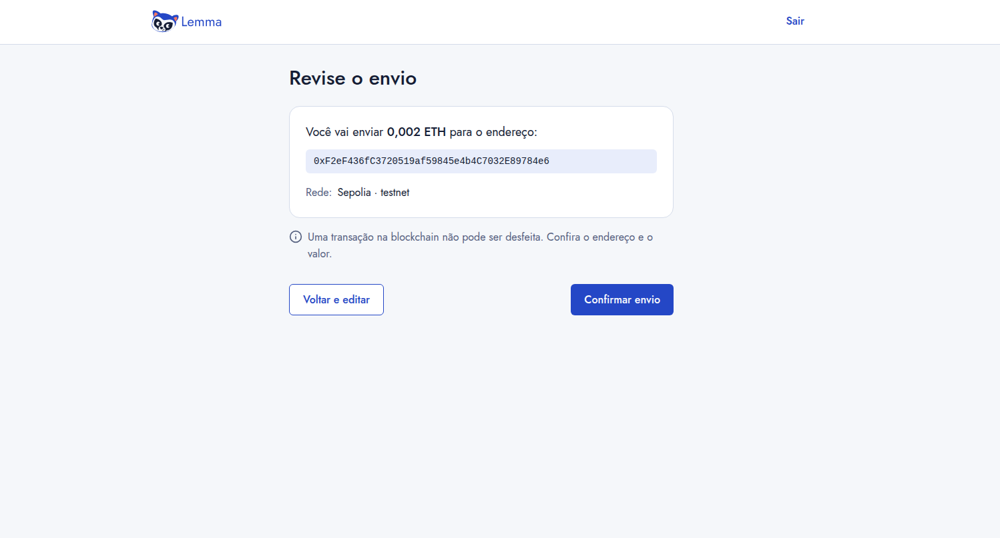

Antes de confirmar, a tela repete valor, endereço e rede, e avisa que uma transação na blockchain não pode ser desfeita. O botão "Confirmar envio" tem trava contra clique duplo. Atende o **E4**.

### 8.10 Acompanhamento: pendente

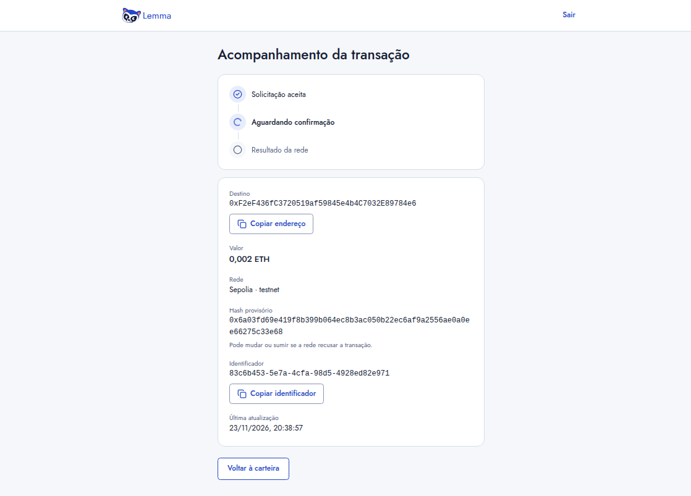

Logo após o envio, a tela mostra que a solicitação foi aceita e está aguardando confirmação, com o identificador da task e o hash provisório, que pode mudar se a rede recusar. A tela consulta o estado sozinha a cada 3 s. Atende o **E4** e o **E5**.

### 8.11 Acompanhamento: confirmada

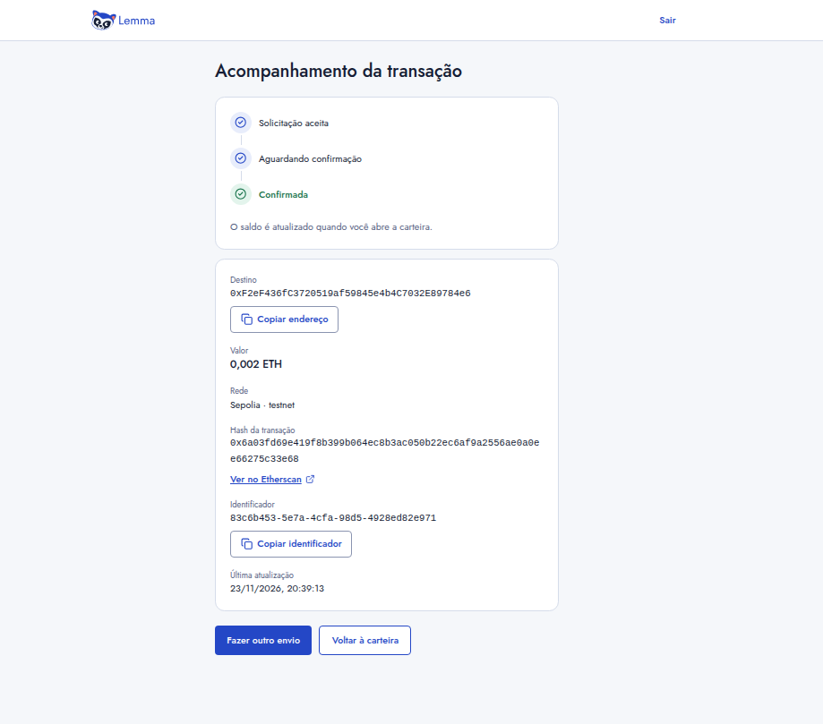

Cerca de 16 s depois, sem recarregar a página, a linha do tempo chega a "Confirmada", o hash deixa de ser provisório e aparece o link para o Etherscan. Atende o **E5** e, por trás, o **E8**.

### 8.12 Carteira com atividade

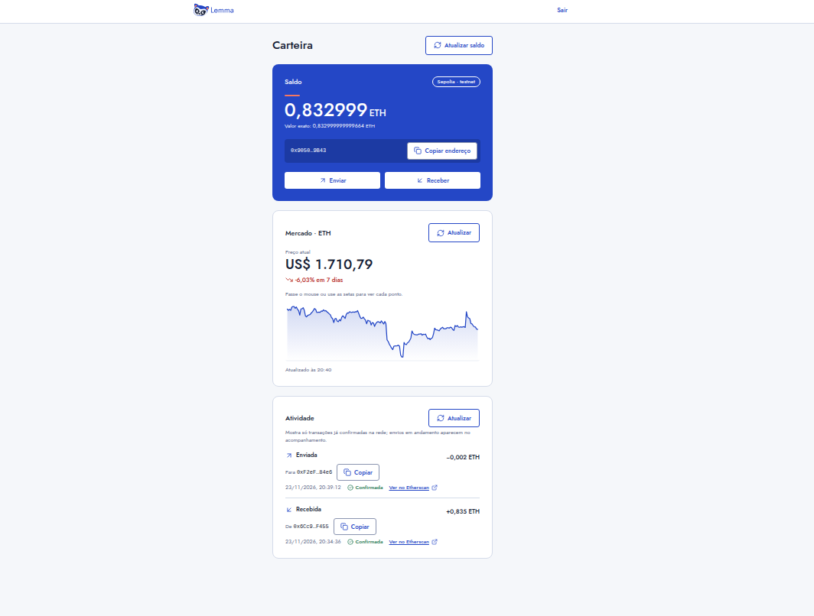

De volta à carteira, o saldo foi relido (0,832999 ETH, com o valor exato logo abaixo, já descontados o envio e a taxa) e a atividade mostra a transação enviada e a recebida, cada uma com o link para o explorador. Atende o **E3** e o **E10**.

### 8.13 Falhas de módulo

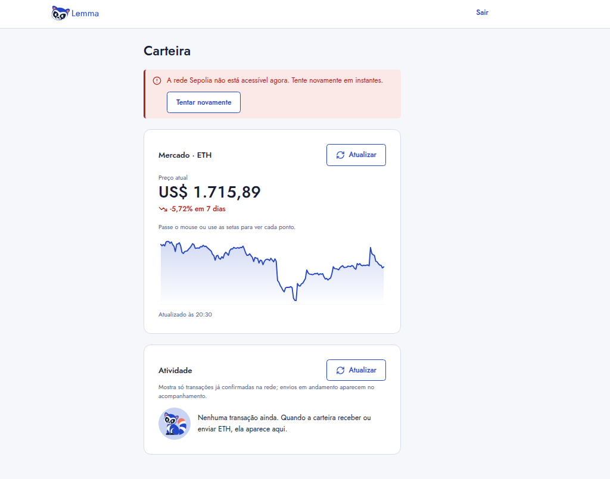

Com o Blockchain Service parado, o saldo mostra "A rede Sepolia não está acessível agora" com botão de tentar de novo, enquanto o mercado e a atividade continuam funcionando, porque vêm de outro módulo (**RNF-02**, TE-09).

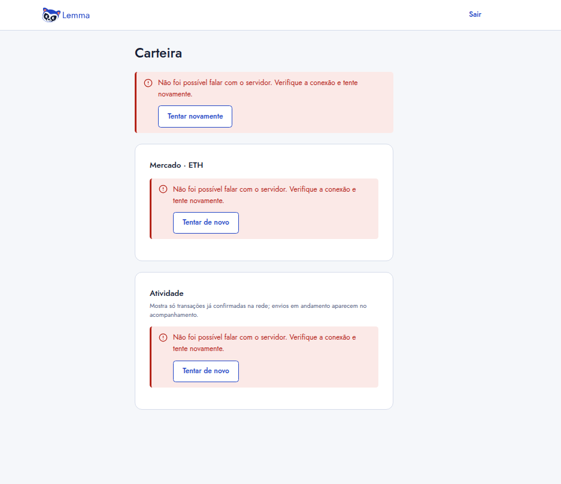

Com o Core API parado, cada painel mostra "Não foi possível falar com o servidor" e um botão de tentar de novo, em vez de uma tela branca (TE-28).

---

## 9. Como rodar

> Responsável: Lucas Athanasio Bueno de Andrade

Como não há repositório principal, cada repositório tem o seu `README.md`, em duas partes: primeiro o módulo daquele repositório (o que faz, o `.env`, como subir só ele e como rodar os testes) e depois a seção **"Como rodar o sistema inteiro"**, com o mesmo texto nos quatro. Assim, quem abrir qualquer uma das quatro releases consegue subir o sistema sem consultar outro repositório.

| Repositório | README |
|---|---|
| Frontend | <https://github.com/IgorFurtadoo/pi4-2026-2-0101-grupo07-frontend/blob/main/README.md> |
| Core API | <https://github.com/IgorFurtadoo/pi4-2026-2-0101-grupo07-core-api/blob/main/README.md> |
| Blockchain Service | <https://github.com/IgorFurtadoo/pi4-2026-2-0101-grupo07-blockchain/blob/main/README.md> |
| External Data Service | <https://github.com/IgorFurtadoo/pi4-2026-2-0101-grupo07-external-data-service/blob/main/README.md> |

No PDF, a parte comum dos quatro READMEs (nome, integrantes, repositórios e "Como rodar o sistema inteiro") é reproduzida na íntegra a seguir.

---

## 10. Conclusão

> Responsável: Lucas Athanasio Bueno de Andrade

**O que o sistema entrega.** Os nove entregáveis da Entrega 1 estão implementados; oito estão prontos e o E7 está parcial, porque o limite funciona e está testado, mas o teste manual de carga ainda não foi registrado. Um entregável novo (E10, histórico) entrou para resolver um problema que só apareceu com o sistema rodando: sem lista, quem fechava a aba perdia a transação. O critério de sucesso da Entrega 1 foi cumprido com transações reais na Sepolia, sem o usuário ver chave privada em nenhum momento.

**O que deu certo.**

- **Contratos antes do código.** As fichas CT da Entrega 2 viraram a lista de tarefas e de testes de cada módulo. As tabelas de erro de cada ficha viraram casos de teste quase sem adaptação.
- **Webhook com consulta ativa.** Os dois caminhos de atualização (ADR 0002) se mostraram necessários: no roteiro real o webhook chegou antes de o Core API ter a linha e recebeu 404, e a consulta ativa resolveu sem intervenção.
- **Gravar antes de enviar.** Guardar o hash e a transação assinada antes de enviar à rede fez a retomada após reinício (E9) funcionar sem código específico de partida.
- **Testar contra a rede real cedo.** Foi assim que a equipe descobriu que o primeiro envio a uma conta nova custava cerca de 207 mil de gás na Sepolia (e não 21 mil, como na Especificação), depois de uma transação revertida por falta de gás (ADR 0005).

**O que deu trabalho e por quê.**

- **Rede de testes que muda.** A Sepolia mudou de regras durante o semestre (Glamsterdam, 06/10/2026), e o custo de gás previsto deixou de valer.
- **Torneiras de ETH de teste.** Várias exigem saldo na mainnet. Só a torneira por mineração (pk910) funcionou.
- **Concorrência.** Garantir que webhook e consulta ativa não regridam nem misturem o estado exigiu uma atualização condicional no banco e um roteiro de concorrência só para isso.
- **Socket tardio.** A disciplina pedia o uso de Socket Java e o canal só entrou na versão 1.1, como terceiro caminho do aviso de task concluída (ADR 0008). Foi acrescentado sem trocar o webhook, para não arriscar o que já estava provado com transações reais; por isso o ganho funcional é pequeno (o aviso chega pelo caminho que vier primeiro), e a justificativa principal é o uso da tecnologia pedida.
- **Quatro repositórios.** Um repositório por módulo isolou bem cada parte e permitiu testar cada uma sozinha, mas a execução do sistema inteiro depende de clonar quatro repositórios, criar uma rede Docker compartilhada e manter a mesma `SERVICE_KEY` em três arquivos `.env`. Um repositório único com um compose do sistema subiria tudo com um comando.

**O que fica para uma próxima versão.**

- Tempo limite de task, retentativa do webhook e idempotência do envio (D-02 e D-03), e o ajuste do teste instável (D-06).
- Limite de tentativas de login (D-04) e recuperação de senha.
- CI com GitHub Actions e análise no SonarQube.
- Estimativa de gás (`eth_estimateGas`) no lugar do limite fixo de 500.000.
- Recuperação ou exportação de carteira, e um KMS para a chave de cifragem em produção.

---

## 11. Anexos

> Responsável: Lucas Athanasio Bueno de Andrade

| Anexo | Link |
|---|---|
| Repositório do Frontend (com o roteiro de execução e a documentação) | <https://github.com/IgorFurtadoo/pi4-2026-2-0101-grupo07-frontend> |
| Repositório do Core API | <https://github.com/IgorFurtadoo/pi4-2026-2-0101-grupo07-core-api> |
| Repositório do Blockchain Service | <https://github.com/IgorFurtadoo/pi4-2026-2-0101-grupo07-blockchain> |
| Repositório do External Data Service | <https://github.com/IgorFurtadoo/pi4-2026-2-0101-grupo07-external-data-service> |
| Quadro do grupo no OpenProject | <https://srv1889234.hstgr.cloud/work_packages/161> |
| Release `v1.0` do Frontend | <https://github.com/IgorFurtadoo/pi4-2026-2-0101-grupo07-frontend/releases/tag/v1.0> |
| Release `v1.0` do Core API | <https://github.com/IgorFurtadoo/pi4-2026-2-0101-grupo07-core-api/releases/tag/v1.0> |
| Release `v1.0` do Blockchain Service | <https://github.com/IgorFurtadoo/pi4-2026-2-0101-grupo07-blockchain/releases/tag/v1.0> |
| Release `v1.0` do External Data Service | <https://github.com/IgorFurtadoo/pi4-2026-2-0101-grupo07-external-data-service/releases/tag/v1.0> |
| Release `v1.1` do Frontend | <https://github.com/IgorFurtadoo/pi4-2026-2-0101-grupo07-frontend/releases/tag/v1.1> |
| Release `v1.1` do Core API | <https://github.com/IgorFurtadoo/pi4-2026-2-0101-grupo07-core-api/releases/tag/v1.1> |
| Release `v1.1` do Blockchain Service | <https://github.com/IgorFurtadoo/pi4-2026-2-0101-grupo07-blockchain/releases/tag/v1.1> |
| Última execução do CI | Não configurado nesta versão |
| Painel do SonarQube | Não configurado nesta versão |

Outros anexos úteis:

| Anexo | Onde |
|---|---|
| Desenho de cada módulo (decisões, divergências e provas) | `docs/desenho-*.md` de cada repositório |
| Guia de identidade visual do Lemma | `docs/identidade/` do repositório do Frontend |
| Transação real de referência na Sepolia | <https://sepolia.etherscan.io/tx/0x846b640b2f2004ce8fa3fe44708d4ffd203eaf06bbf0a67d32dda066ef3365c8> |