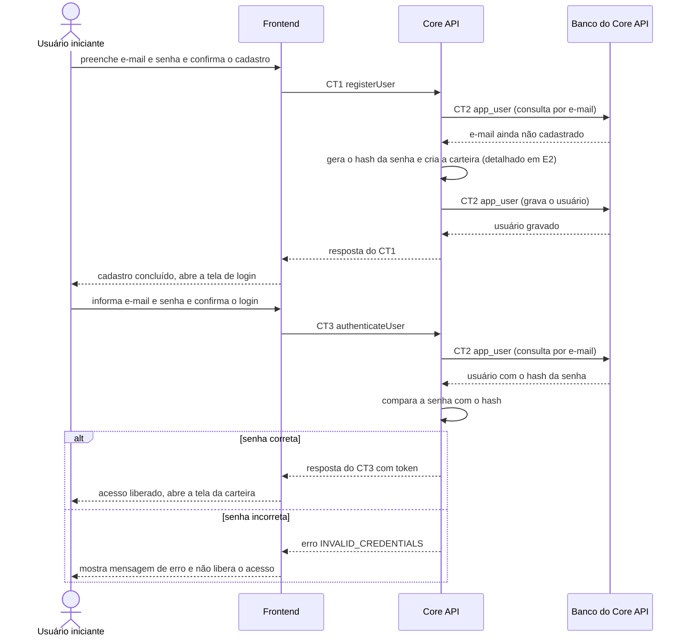

# Fluxo do E1: Cadastro e autenticação de usuário

**Feito quando (da Entrega 1):** O usuário se cadastra com e-mail e senha, consegue fazer login em seguida, e uma senha incorreta exibe mensagem de erro sem permitir o acesso.

## Passos

1. O Usuário iniciante preenche e-mail e senha na tela de cadastro e confirma.
2. O Frontend envia ao Core API o contrato CT1 `registerUser` (`POST /users`) com `email` e `password`.
3. O Core API valida o formato do e-mail e o tamanho da senha. Depois consulta o Banco do Core API por e-mail (CT2 `app_user`) para garantir que o e-mail ainda não existe.
4. O Core API gera o hash da senha, cria a carteira custodial (detalhado no fluxo E2) e grava o usuário em CT2 `app_user` com o hash da senha e o endereço Ethereum.
5. O Core API responde `201` com `userId`, `email` e `ethereumAddress`. O Frontend mostra que o cadastro foi concluído e abre a tela de login.
6. O Usuário iniciante informa e-mail e senha e confirma o login. O Frontend envia o contrato CT3 `authenticateUser` (`POST /auth/login`).
7. O Core API lê o usuário por e-mail (CT2 `app_user`) e compara a senha informada com o hash armazenado.
8. Senha correta: o Core API emite um token JWT e responde `200` com `token` e `expiresAt`. O Frontend guarda o token para as chamadas seguintes e abre a tela da carteira.
9. Senha incorreta: o Core API responde `401` com `INVALID_CREDENTIALS`. O Frontend exibe a mensagem de erro e não guarda token, então o acesso não é liberado.

## Diagrama

**Contratos usados:** CT1 `registerUser`, CT2 `app_user`, CT3 `authenticateUser`.
