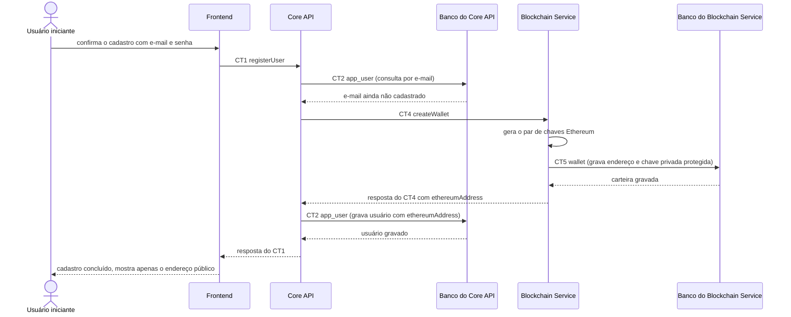

# Fluxo do E2: Criação automática de carteira custodial

**Feito quando (da Entrega 1):** Ao concluir o cadastro, o sistema gera e associa automaticamente um endereço Ethereum ao usuário, sem que ele informe ou visualize qualquer chave privada.

## Passos

1. O Usuário iniciante confirma o cadastro com e-mail e senha. Em nenhum momento a tela pede ou mostra chave privada.
2. O Frontend envia ao Core API o contrato CT1 `registerUser` (`POST /users`).
3. O Core API valida os dados e consulta o Banco do Core API por e-mail (CT2 `app_user`) para garantir que o e-mail ainda não existe.
4. O Core API pede ao Blockchain Service a criação da carteira com o contrato CT4 `createWallet` (`POST /wallets`), sem corpo e com o cabeçalho `X-Service-Key`.
5. O Blockchain Service gera o par de chaves Ethereum, internamente, e grava o endereço e a chave privada protegida na tabela `wallet` do Banco do Blockchain Service (CT5 `wallet`).
6. O Blockchain Service responde `201` ao Core API somente com `ethereumAddress` e `network`. A chave privada nunca sai do Blockchain Service.
7. O Core API grava o usuário com o hash da senha e o `ethereumAddress` em CT2 `app_user`. Isso associa o endereço ao usuário.
8. O Core API responde `201` com `userId`, `email` e `ethereumAddress`. O Frontend mostra a confirmação do cadastro com o endereço público.

## Diagrama

**Contratos usados:** CT1 `registerUser`, CT2 `app_user`, CT4 `createWallet`, CT5 `wallet`.
