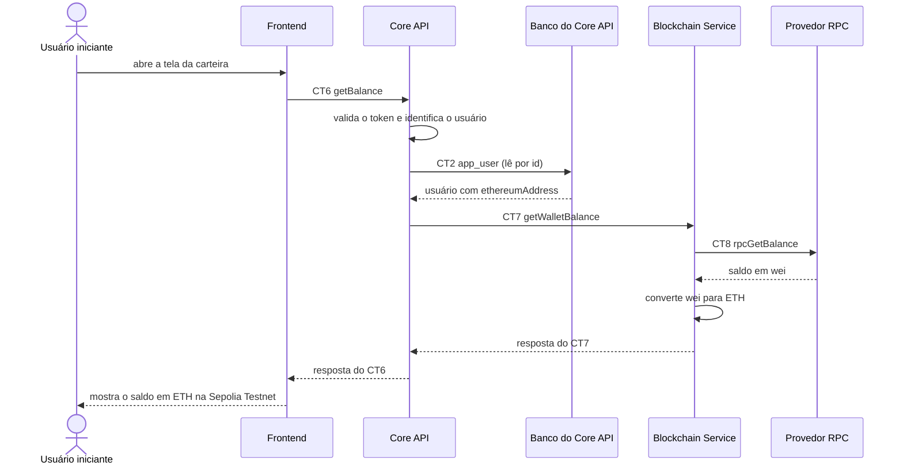

# Fluxo do E3: Consulta de saldo da carteira

**Feito quando (da Entrega 1):** O usuário abre a tela da carteira e vê o saldo atual em ETH na rede Sepolia Testnet, obtido em tempo real via provedor RPC.

## Passos

1. O Usuário iniciante abre a tela da carteira.
2. O Frontend envia ao Core API o contrato CT6 `getBalance` (`GET /wallet/balance`) com o cabeçalho `Authorization: Bearer <token>`.
3. O Core API valida o token e identifica o usuário. Depois lê o usuário no Banco do Core API (CT2 `app_user`, por `id`) para obter o `ethereumAddress`.
4. O Core API pede o saldo ao Blockchain Service com o contrato CT7 `getWalletBalance` (`GET /wallets/{ethereumAddress}/balance`).
5. O Blockchain Service consulta o Provedor RPC com o contrato CT8 `rpcGetBalance` (`eth_getBalance`, bloco `latest`).
6. O Provedor RPC devolve o saldo em wei. O Blockchain Service converte para ETH e responde ao Core API com `ethereumAddress`, `balanceEth` e `network`.
7. O Core API repassa a resposta ao Frontend, que mostra o saldo em ETH na Sepolia Testnet.

## Diagrama

**Contratos usados:** CT2 `app_user`, CT6 `getBalance`, CT7 `getWalletBalance`, CT8 `rpcGetBalance`.
