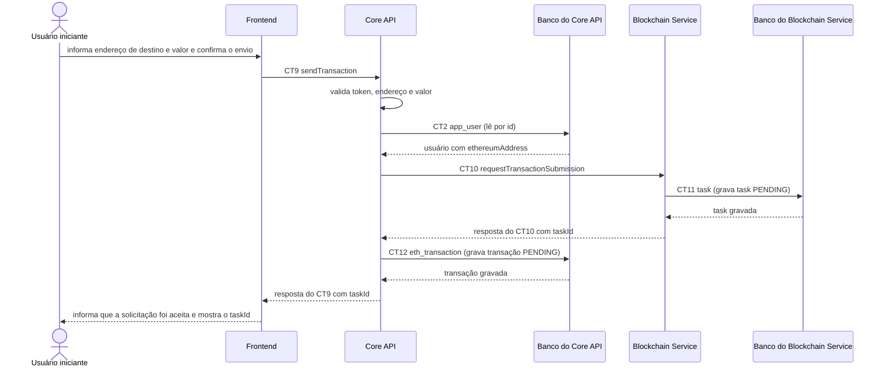

# Fluxo do E4: Envio de transação simples

**Feito quando (da Entrega 1):** O usuário informa um endereço de destino e um valor, confirma o envio, e recebe imediatamente um identificador de acompanhamento (task) confirmando que a solicitação foi aceita.

## Passos

1. O Usuário iniciante informa o endereço de destino e o valor em ETH e confirma o envio.
2. O Frontend envia ao Core API o contrato CT9 `sendTransaction` (`POST /transactions`) com `destinationAddress` e `amountEth`, mais o cabeçalho `Authorization: Bearer <token>`.
3. O Core API valida o token, o formato do endereço e o valor. Depois lê o usuário no Banco do Core API (CT2 `app_user`, por `id`) para obter o `ethereumAddress`, que será o `sourceAddress`.
4. O Core API solicita o envio ao Blockchain Service com o contrato CT10 `requestTransactionSubmission` (`POST /transactions`), com `sourceAddress`, `destinationAddress` e `amountEth`.
5. O Blockchain Service valida a solicitação e grava uma task com estado `PENDING` na tabela `task` do Banco do Blockchain Service (CT11 `task`). O processamento real fica para o segundo plano (fluxos E5 e E8).
6. O Blockchain Service responde `202` ao Core API com `taskId` e `status` `PENDING`.
7. O Core API grava a transação com o `taskId`, o `userId` e o estado `PENDING` no Banco do Core API (CT12 `eth_transaction`).
8. O Core API responde `202` ao Frontend com `taskId` e `status`. O Frontend informa que a solicitação foi aceita e mostra o `taskId`.

## Diagrama

**Contratos usados:** CT2 `app_user`, CT9 `sendTransaction`, CT10 `requestTransactionSubmission`, CT11 `task`, CT12 `eth_transaction`.
