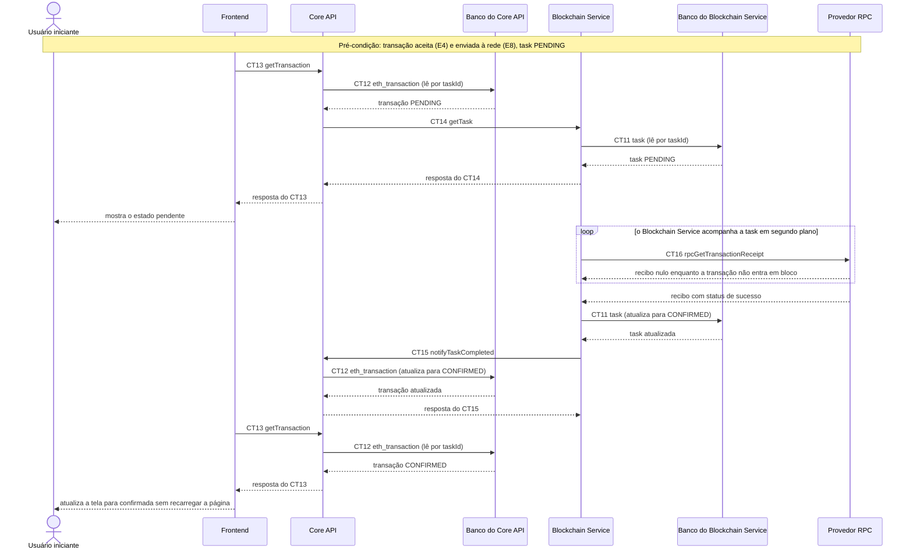

# Fluxo do E5: Acompanhamento assíncrono da transação

**Feito quando (da Entrega 1):** O usuário acompanha, na mesma tela, o estado da transação evoluindo de "pendente" para "confirmada" (ou "falhou"), atualizado automaticamente por polling, sem recarregar a página.

## Passos

1. Pré-condição: a transação já foi aceita (fluxo E4) e a task está `PENDING`. O envio à rede acontece em segundo plano (fluxo E8).
2. O Usuário iniciante permanece na tela da transação. O Frontend faz polling com o contrato CT13 `getTransaction` (`GET /transactions/{taskId}`), com o cabeçalho `Authorization: Bearer <token>`.
3. O Core API lê a transação no Banco do Core API (CT12 `eth_transaction`). Como o estado local ainda é `PENDING`, consulta ativamente o Blockchain Service com o contrato CT14 `getTask` (`GET /tasks/{taskId}`).
4. O Blockchain Service lê a task no Banco do Blockchain Service (CT11 `task`) e responde `PENDING`. O Core API devolve `PENDING` ao Frontend, que mostra "pendente".
5. Em segundo plano, o Blockchain Service consulta o Provedor RPC com o contrato CT16 `rpcGetTransactionReceipt` (`eth_getTransactionReceipt`) até haver recibo.
6. Com o recibo, o Blockchain Service atualiza a task no Banco do Blockchain Service (CT11 `task`) para `CONFIRMED`. Se o recibo indicar reversão ou a rede rejeitar a transação, a task vai para `FAILED` com um `failureReason`.
7. O Blockchain Service notifica o Core API por webhook com o contrato CT15 `notifyTaskCompleted` (`POST /webhooks/tasks`). O Core API atualiza a transação em CT12 `eth_transaction` e responde `204`.
8. No polling seguinte, o Frontend chama CT13 `getTransaction` e o Core API lê o estado `CONFIRMED` (ou `FAILED`) em CT12 `eth_transaction`. O Frontend atualiza a tela para "confirmada" (ou "falhou") sem recarregar a página e encerra o polling.
9. Se o webhook não chegar, o estado local continua `PENDING`. A consulta ativa (CT14 `getTask`) do passo 3 repete a cada polling e traz o estado final.

## Diagrama

**Contratos usados:** CT11 `task`, CT12 `eth_transaction`, CT13 `getTransaction`, CT14 `getTask`, CT15 `notifyTaskCompleted`, CT16 `rpcGetTransactionReceipt`.
