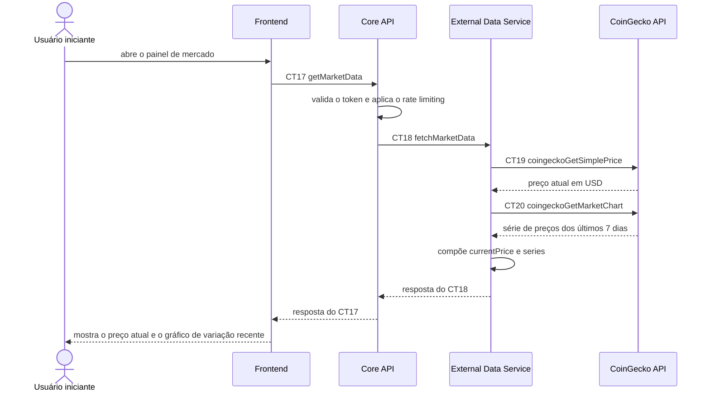

# Fluxo do E6: Painel de informações de mercado

**Feito quando (da Entrega 1):** O usuário visualiza o preço atual e um gráfico de variação recente de pelo menos um criptoativo, obtidos da API da CoinGecko.

## Passos

1. O Usuário iniciante abre o painel de mercado e o Frontend escolhe o criptoativo (`ethereum`).
2. O Frontend envia ao Core API o contrato CT17 `getMarketData` (`GET /market/{assetId}`), com o cabeçalho `Authorization: Bearer <token>`.
3. O Core API valida o token e verifica o rate limiting (detalhado no fluxo E7). Dentro do limite, pede os dados ao External Data Service com o contrato CT18 `fetchMarketData` (`GET /market/{assetId}`).
4. O External Data Service consulta a CoinGecko API com o contrato CT19 `coingeckoGetSimplePrice` (`/simple/price`) para o preço atual.
5. O External Data Service consulta a CoinGecko API com o contrato CT20 `coingeckoGetMarketChart` (`/coins/{id}/market_chart`, últimos 7 dias) para a série do gráfico.
6. O External Data Service compõe `currentPrice` e `series` e responde `200` ao Core API, que repassa ao Frontend.
7. O Frontend mostra o preço atual e desenha o gráfico de variação dos últimos 7 dias.

## Diagrama

**Contratos usados:** CT17 `getMarketData`, CT18 `fetchMarketData`, CT19 `coingeckoGetSimplePrice`, CT20 `coingeckoGetMarketChart`.
