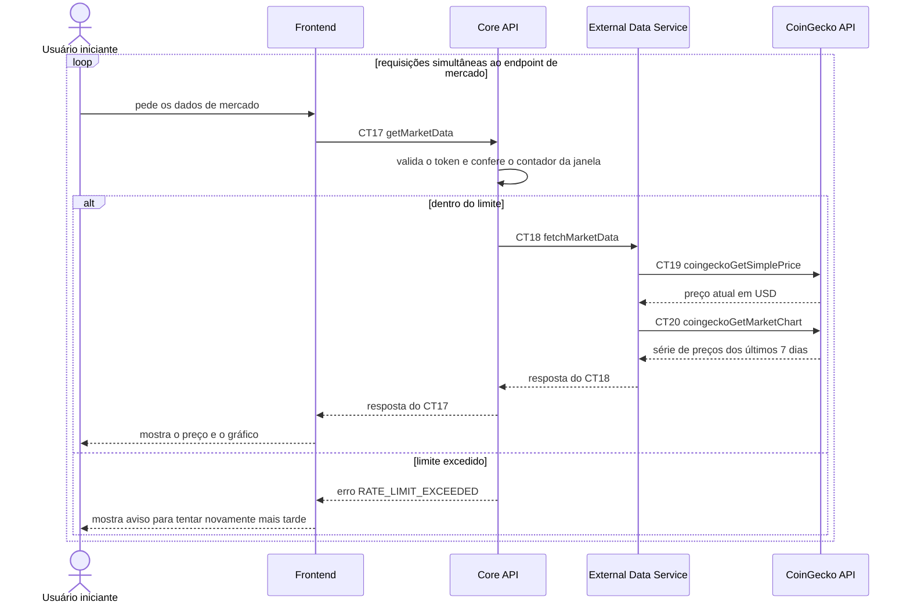

# Fluxo do E7: Rate limiting na integração com CoinGecko

**Feito quando (da Entrega 1):** Uma sequência de requisições simultâneas ao endpoint de mercado é limitada pela própria aplicação antes de atingir o limite gratuito da CoinGecko, verificado em teste manual de carga.

## Passos

1. O Usuário iniciante (no teste manual de carga, de forma repetida e simultânea) faz várias requisições ao endpoint de mercado pelo Frontend.
2. Cada requisição chega ao Core API pelo contrato CT17 `getMarketData` (`GET /market/{assetId}`), com o cabeçalho `Authorization: Bearer <token>`.
3. O Core API valida o token e consulta seu contador de requisições da janela de tempo. O limite é configuração do Core API e fica abaixo do limite gratuito da CoinGecko (premissa P5).
4. Requisição dentro do limite: o Core API chama o External Data Service (CT18 `fetchMarketData`), que consulta a CoinGecko API (CT19 `coingeckoGetSimplePrice` e CT20 `coingeckoGetMarketChart`). A resposta `200` volta ao Frontend (fluxo E6).
5. Requisição acima do limite: o Core API responde `429` com `RATE_LIMIT_EXCEEDED` e o cabeçalho `Retry-After`. Ele **não** chama o External Data Service nem a CoinGecko API.
6. O Frontend mostra uma mensagem de que há requisições demais e pede para tentar novamente mais tarde.
7. A verificação do teste manual de carga é que a CoinGecko não devolve `429` ao sistema enquanto o Core API devolve `429` às requisições excedentes.

## Diagrama

**Contratos usados:** CT17 `getMarketData`, CT18 `fetchMarketData`, CT19 `coingeckoGetSimplePrice`, CT20 `coingeckoGetMarketChart`.
