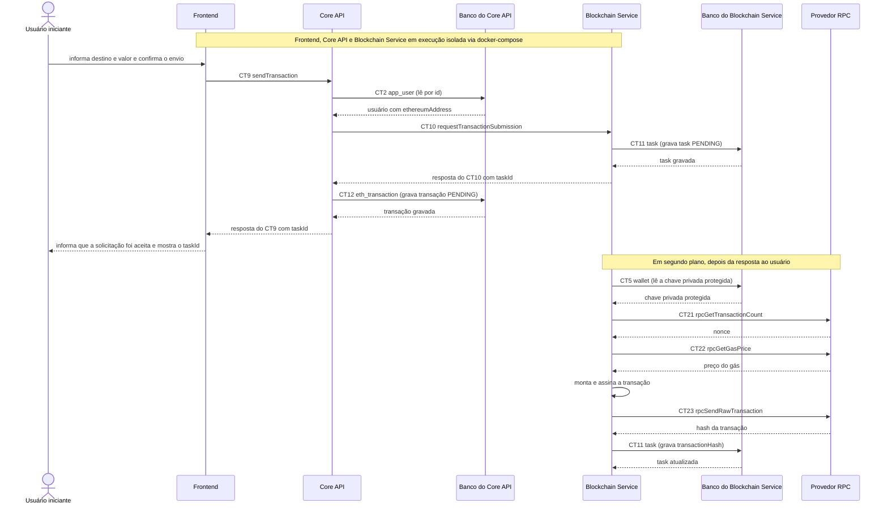

# Fluxo do E8: Comunicação REST entre os três containers

**Feito quando (da Entrega 1):** Uma transação enviada pelo frontend percorre Container 2 → Container 3 → provedor RPC e retorna uma resposta ao usuário, com os três containers em execução isolada via docker-compose.

## Passos

1. Pré-condição: Frontend, Core API (Container 2) e Blockchain Service (Container 3) estão em execução isolada pelo docker-compose, cada um no seu container, e se comunicam pela rede do compose.
2. O Usuário iniciante informa destino e valor e confirma o envio. O Frontend envia ao Core API o contrato CT9 `sendTransaction` (`POST /transactions`), com o cabeçalho `Authorization: Bearer <token>`.
3. O Core API valida o token e lê o usuário no Banco do Core API (CT2 `app_user`) para obter o endereço de origem.
4. O Core API chama o Blockchain Service com o contrato CT10 `requestTransactionSubmission` (`POST /transactions`).
5. O Blockchain Service grava a task `PENDING` (CT11 `task`) e responde `202` com `taskId`. O Core API grava a transação (CT12 `eth_transaction`) e responde `202` ao Frontend, que informa a resposta ao Usuário iniciante.
6. Em segundo plano, o Blockchain Service lê a chave privada protegida da carteira de origem (CT5 `wallet`).
7. O Blockchain Service obtém o nonce com o contrato CT21 `rpcGetTransactionCount` (`eth_getTransactionCount`) e o preço do gás com o contrato CT22 `rpcGetGasPrice` (`eth_gasPrice`), ambos junto ao Provedor RPC.
8. O Blockchain Service monta a transação (limite de gás 21000, chainId da Sepolia), assina com a chave privada e a envia ao Provedor RPC com o contrato CT23 `rpcSendRawTransaction` (`eth_sendRawTransaction`).
9. O Provedor RPC devolve o hash da transação. O Blockchain Service grava o `transactionHash` na task (CT11 `task`). O acompanhamento até a confirmação segue no fluxo E5.

## Diagrama

**Contratos usados:** CT2 `app_user`, CT5 `wallet`, CT9 `sendTransaction`, CT10 `requestTransactionSubmission`, CT11 `task`, CT12 `eth_transaction`, CT21 `rpcGetTransactionCount`, CT22 `rpcGetGasPrice`, CT23 `rpcSendRawTransaction`.
