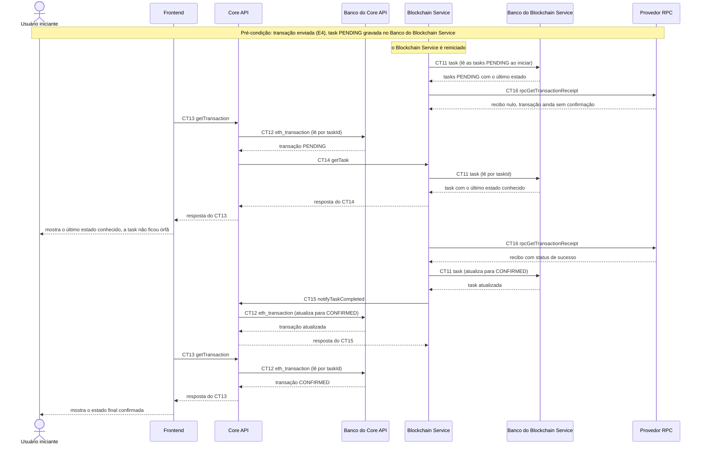

# Fluxo do E9: Persistência do estado das tasks (Container 3)

**Feito quando (da Entrega 1):** Após um reinício do Container 3, uma task registrada antes do reinício continua consultável com o último estado conhecido, sem ficar "órfã".

## Passos

1. Pré-condição: o Usuário iniciante enviou uma transação (fluxo E4). A task está gravada como `PENDING` no Banco do Blockchain Service (CT11 `task`) e o Core API tem a transação `PENDING` (CT12 `eth_transaction`).
2. O Blockchain Service (Container 3) é reiniciado. O estado das tasks está no Banco do Blockchain Service, não na memória do processo.
3. Ao subir, o Blockchain Service lê no Banco do Blockchain Service as tasks ainda `PENDING` (CT11 `task`) e retoma o acompanhamento de cada uma, consultando o Provedor RPC (CT16 `rpcGetTransactionReceipt`).
4. Com o Blockchain Service já reiniciado, o Frontend faz polling com o contrato CT13 `getTransaction`. O Core API lê a transação em CT12 `eth_transaction` (`PENDING`) e consulta o Blockchain Service com o contrato CT14 `getTask`.
5. O Blockchain Service lê a task em CT11 `task` e responde com o último estado conhecido (`PENDING`). A task continua consultável e não ficou órfã. O Frontend mostra o estado ao Usuário iniciante.
6. Quando o recibo aparece, o Blockchain Service atualiza a task (CT11 `task`) para `CONFIRMED` (ou `FAILED`) e notifica o Core API com o contrato CT15 `notifyTaskCompleted`. O Core API atualiza CT12 `eth_transaction`.
7. No polling seguinte, o Frontend recebe o estado final pelo contrato CT13 `getTransaction`.

## Diagrama

**Contratos usados:** CT11 `task`, CT12 `eth_transaction`, CT13 `getTransaction`, CT14 `getTask`, CT15 `notifyTaskCompleted`, CT16 `rpcGetTransactionReceipt`.
