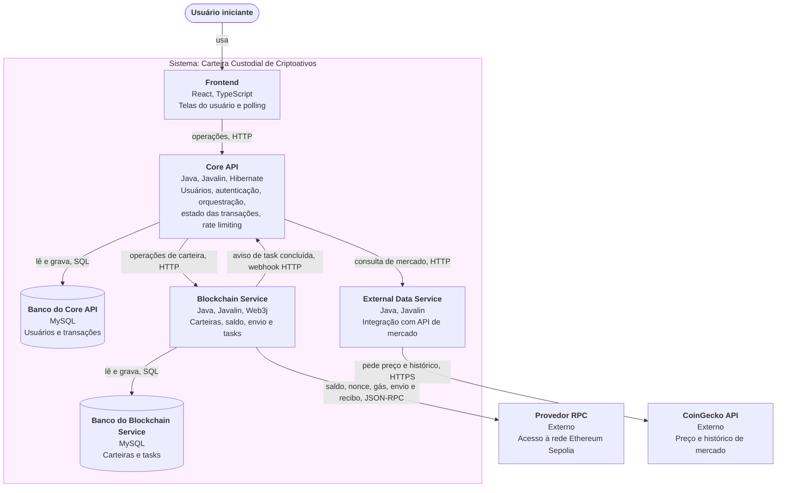

# Visão geral

**Projeto:** Carteira Custodial de Criptoativos (Ethereum Sepolia Testnet)
**Equipe:** Grupo 07 · Turma 0101 · PUC-Campinas, Projeto Integrador IV, 2026-2
**Base:** Entrega 1 (`ESCOPO-0101-grupo07.pdf`), entregáveis E1 a E9.

## 1. Mudança em relação à Entrega 1

Nenhum entregável foi criado, removido ou teve o "feito quando" alterado. Houve uma mudança de arquitetura decidida depois da Entrega 1:

| O que mudou | Entregáveis afetados | Por que mudou |
|---|---|---|
| A aplicação passa de 3 para 4 containers de aplicação. A integração com APIs externas de mercado sai do Core API (Container 2) e passa a ser o módulo External Data Service. | E6 e E7: o Core API deixa de chamar a CoinGecko diretamente e passa a chamar o External Data Service. E8 e OE4: o texto cita "três containers", mas o caminho de E8 (Container 2, Container 3, provedor RPC) não passa pelo novo módulo e continua válido. | A equipe decidiu manter um repositório por implementação. A integração externa fica isolada e com nome neutro, porque pode não usar a CoinGecko no futuro. |

Correspondência de nomes: Container 1 é o **Frontend**, Container 2 é o **Core API** e Container 3 é o **Blockchain Service**.

A revisão formal da arquitetura por causa dessa decisão ainda não foi feita. Esta especificação a trata como decidida e marca como premissa (seção 5) os pontos que dependem dela.

## 2. Módulos

| Módulo | O que faz | Tecnologia | Repositório | Responsável |
|---|---|---|---|---|
| Frontend | Telas de cadastro, login, carteira, envio de transação, acompanhamento e painel de mercado. Faz polling do estado da transação. Fala somente com o Core API. | React, TypeScript, Tailwind CSS, React Router (SPA, sem SSR) | `pi4-2026-2-0101-grupo07-frontend` | Sem responsável definido |
| Core API | Ponto único de contato do Frontend. Cadastro, autenticação, associação do usuário ao endereço Ethereum, orquestração das operações de carteira, estado das transações para o Frontend e rate limiting do endpoint de mercado. | Java, Javalin, Hibernate | `pi4-2026-2-0101-grupo07-core-api` | Guillermo e Nicollas |
| Banco do Core API | Armazena usuários e transações. Banco próprio do Core API. | MySQL | Esquema definido em `pi4-2026-2-0101-grupo07-core-api` | Guillermo e Nicollas (responsáveis do Core API, dono do banco) |
| Blockchain Service | Toda a comunicação com a Ethereum: gera carteiras, guarda as chaves privadas, consulta saldo, assina e envia transações, acompanha o resultado como task assíncrona e notifica o Core API por webhook. | Java, Javalin, Web3j | `pi4-2026-2-0101-grupo07-blockchain` | Igor |
| Banco do Blockchain Service | Armazena carteiras (com a chave privada protegida) e tasks. Garante que as tasks sobrevivam a reinícios. Banco próprio do Blockchain Service. | MySQL | Esquema definido em `pi4-2026-2-0101-grupo07-blockchain` | Igor (responsável do Blockchain Service, dono do banco) |
| External Data Service | Integração com APIs externas de mercado. Por ora consulta a CoinGecko e devolve preço atual e histórico recente. | Java, Javalin | `pi4-2026-2-0101-grupo07-external-data-service` | Lucas |
| Provedor RPC | Serviço externo que dá acesso à rede Ethereum Sepolia por JSON-RPC. Não há node próprio. Endpoint público gratuito, proposto: PublicNode (https://ethereum-sepolia-rpc.publicnode.com), configurado por variável de ambiente. Escolha final a confirmar. | JSON-RPC sobre HTTPS (terceiro) | Não se aplica (terceiro) | Igor (responde pela integração, feita no Blockchain Service) |
| CoinGecko API | Serviço externo de dados de mercado (preço e histórico), no plano Demo gratuito (chave de API gratuita, base https://api.coingecko.com/api/v3). | API REST sobre HTTPS (terceiro) | Não se aplica (terceiro) | Lucas (responde pela integração, feita no External Data Service) |

A pessoa que usa o sistema é o **Usuário iniciante**, definido na Entrega 1 (hipótese de projeto, sem evidência de campo).

## 3. Diagrama de contêineres

## 4. Convenção de nomes

Decidida pela equipe: nomes em inglês, seguindo a convenção Java no backend e a convenção JavaScript no frontend. A documentação continua em português. Esta convenção vale para todos os documentos desta entrega.

| Item | Convenção | Exemplo |
|---|---|---|
| Idioma dos nomes | Inglês para campos, contratos, endpoints, enums e códigos de erro | `ethereumAddress`, `getBalance` |
| Campos entre módulos (JSON, parâmetros) | `camelCase` (vale para Java e JavaScript) | `ethereumAddress`, `amountEth`, `taskId` |
| Nomes de contrato e operação | `camelCase`, verbo + objeto. Contratos de serviço externo levam o prefixo do serviço (`rpc`, `coingecko`). Contratos de banco levam o nome da tabela. | `registerUser`, `rpcGetBalance`, `app_user` |
| Endpoints | minúsculas, `kebab-case`, coleções no plural. Parâmetros de caminho entre chaves em `camelCase`. | `POST /transactions`, `GET /transactions/{taskId}` |
| Campos do banco | `snake_case`, tabelas no singular (premissa P9). O mapeamento `camelCase` ↔ `snake_case` é mecânico. As fichas de banco listam o nome da coluna. | `ethereum_address` ↔ `ethereumAddress` |
| Enums e valores fechados | `UPPER_SNAKE_CASE`, como constantes Java, enviados como texto no JSON. O Frontend converte em rótulos em português. | `PENDING`, `CONFIRMED`, `FAILED` |
| Códigos de erro | `UPPER_SNAKE_CASE` | `EMAIL_ALREADY_REGISTERED` |
| Eventos e mensagens | O sistema só tem o webhook do Blockchain Service para o Core API. Ele é um `POST` com corpo JSON, nomeado como contrato em `camelCase`. | `notifyTaskCompleted` |
| Datas e horas | ISO 8601 em UTC | `2026-10-20T14:30:00Z` |
| Valores em ETH | decimal em ETH (não em wei), ponto como separador | `0.01` |
| Erros HTTP | Status HTTP + corpo JSON com `code` (texto) e `message` (texto legível, pode ser exibido ao usuário). Nas fichas, a coluna "O que volta" cita o status e o `code`. | `409`, `EMAIL_ALREADY_REGISTERED` |
| Cabeçalhos | `Authorization: Bearer <token>` (Frontend para Core API). `X-Service-Key` (Core API e Blockchain Service entre si). | |
| Serviços externos | Campos e valores originais do serviço são mantidos e não seguem esta convenção (por exemplo `vs_currency`, `eth_getBalance`, `latest`). | |
| Nome dos arquivos de fluxo | Slug em português, derivado do nome do entregável | `E3-consulta-de-saldo-da-carteira.md` |

Mapeamento dos estados para o que o usuário vê (Entrega 1): `PENDING` é "pendente", `CONFIRMED` é "confirmada" e `FAILED` é "falhou".

## 5. Premissas desta especificação

A Proposta Arquitetural deixou alguns pontos em aberto, e contratos exigem decisões concretas. As premissas abaixo foram assumidas para permitir a especificação e confirmadas pela equipe em 13/10/2026, exceto a escolha final do provedor RPC (P8).

| ID | Premissa |
|---|---|
| P1 | A autenticação usa JWT. O login (e-mail e senha) devolve um token JWT assinado pelo Core API. O Frontend o envia em `Authorization: Bearer <token>`. O Core API o valida internamente, sem consultar outro módulo. Todas as rotas do Core API exigem token, exceto `registerUser` e `authenticateUser`. |
| P2 | As chamadas do Core API ao Blockchain Service e o webhook do Blockchain Service ao Core API levam o cabeçalho `X-Service-Key`, com chave compartilhada configurada por variável de ambiente. A chamada do Core API ao External Data Service não tem autenticação (rede interna do docker-compose, sem dado sensível). |
| P3 | Estados da task: `PENDING`, `CONFIRMED`, `FAILED` (correspondem a "pendente", "confirmada" e "falhou" da Entrega 1). A modelagem formal continua em aberto. Uma transação é `CONFIRMED` quando o recibo indica sucesso (1 confirmação). A política de N blocos continua em aberto. |
| P4 | O Frontend encerra o polling quando o estado é `CONFIRMED` ou `FAILED`. Enquanto o estado local for `PENDING`, o Core API consulta ativamente o Blockchain Service a cada polling (consulta ativa, além do webhook). Tempo limite da task e retentativa de webhook continuam em aberto e não estão cobertos por contrato. |
| P5 | O rate limiting fica no Core API, sobre o endpoint de mercado, como na Proposta. O valor do limite é configuração do Core API e deve ficar abaixo do limite do plano Demo da CoinGecko (cerca de 30 chamadas por minuto segundo a documentação oficial). Ao revisar a arquitetura, a equipe pode decidir movê-lo para o External Data Service. |
| P6 | O cadastro é síncrono: o Core API só grava o usuário depois que o Blockchain Service criou a carteira. Se a carteira falhar, o usuário não é gravado. A carteira é sempre criada pelo sistema, sem importação de chave externa (conforme E2 da Entrega 1). |
| P7 | A chave privada fica cifrada na tabela `wallet` do Banco do Blockchain Service e nunca sai do Blockchain Service. O mecanismo de cifragem e recuperação continua em aberto (fora do escopo, Parte 4 da Entrega 1). |
| P8 | O provedor RPC é um endpoint público gratuito da Sepolia (proposta: PublicNode), configurado por variável de ambiente. Os contratos usam JSON-RPC padrão da Ethereum. A transação é do tipo legado (preço de gás por `eth_gasPrice`), com limite de gás 21000 (transferência simples) e chainId da Sepolia (11155111). |
| P9 | A equipe não definiu a convenção do banco. Foi assumido `snake_case` em tabelas e colunas, com tabelas no singular (`app_user` evita a palavra reservada `user`). |
| P10 | A CoinGecko é usada no plano Demo gratuito. O External Data Service envia a chave de API no cabeçalho `x-cg-demo-api-key`, lida de variável de ambiente. A chave nunca vai para o Frontend nem para o repositório. |

## 6. Índice de fluxos

| Entregável | Arquivo |
|---|---|
| E1 | `E1-cadastro-e-autenticacao-de-usuario.md` |
| E2 | `E2-criacao-automatica-de-carteira-custodial.md` |
| E3 | `E3-consulta-de-saldo-da-carteira.md` |
| E4 | `E4-envio-de-transacao-simples.md` |
| E5 | `E5-acompanhamento-assincrono-da-transacao.md` |
| E6 | `E6-painel-de-informacoes-de-mercado.md` |
| E7 | `E7-rate-limiting-na-integracao-com-coingecko.md` |
| E8 | `E8-comunicacao-rest-entre-os-tres-containers.md` |
| E9 | `E9-persistencia-do-estado-das-tasks.md` |
